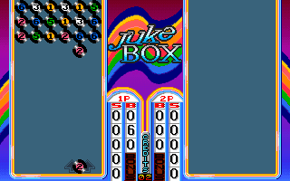
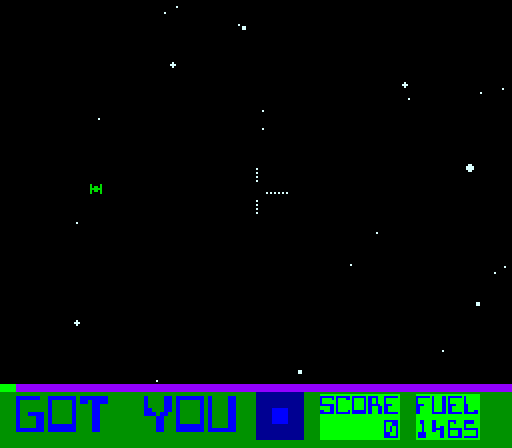
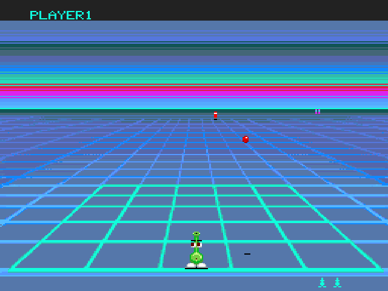
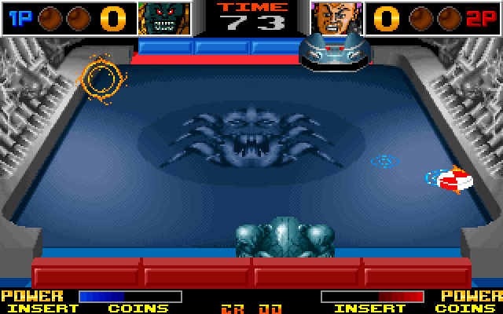

<h1 align="center">
  <br>
  scry-mame
</h1>

<p align="center"><b>Ask your AI client what an arcade game is doing, and it finds out: it stops the game, reads its memory and presses its controls.</b></p>

<p align="center">
  <a href="#install">Install</a> ·
  <a href="#what-you-can-ask">What you can ask</a> ·
  <a href="#see-it-run">Demos</a> ·
  <a href="REFERENCE.md">Reference</a>
</p>

<!-- demo-lead:begin lineup -->
<p align="center"><a href="demos/lineup/"><picture><source media="(prefers-reduced-motion: reduce)" srcset="demos/lineup/screen.png"></picture></a></p>
<p align="center"><em>LineUp on its arcade board, played through this server: each shot is one <code>input</code> call, by the names MAME gives the controls.</em></p>

<table align="center">
<tr><th align="left">You ask</th><td>A coin is in. Read the game's <code>Credits</code> variable by its name.</td></tr>
<tr><th align="left">Your client calls</th><td><code>read_memory(ref="Credits", length=2)</code></td></tr>
<tr><th align="left">SCRY answers</th><td><code>{"ref": "Credits", "hex": "0300"}</code></td></tr>
<tr><th align="left">Your client learns</th><td>Credits holds 3</td></tr>
</table>
<!-- demo-lead:end lineup -->

scry-mame is an [MCP](https://modelcontextprotocol.io) server for
[MAME](https://www.mamedev.org), the emulator of arcade boards and home computers. It gives
your client a MAME held open at its debugger, so a question costs one call, not a boot.

Your client reads registers and memory by your program's own symbol names, sets breakpoints and
watches, presses the machine's controls, and reads its screen and its graphics. Replies carry
their evidence: a loaded state is read back, and a missed target says the game was still
running.

The clip is [the LineUp demo](demos/lineup/), which needs the game's own ROM set.
[Your first question](#your-first-question) needs only a ROM that is free to download.

## Install

You need git, [uv](https://docs.astral.sh/uv/) and a MAME built with its gdbstub and its
`console` plugin, on macOS or Windows.

```sh
git clone https://github.com/scry-mcp/scry-mame
cd scry-mame
```

### Add it to your client

<!-- scry-install:begin -->
<details open><summary>Claude Code</summary>

Run this from the clone. `--scope user` makes the server available to you across all projects, and `claude mcp list` shows it.

```sh
claude mcp add --scope user mame -- uv run --directory "$PWD" scry-mame
```

</details>

<details><summary>Codex</summary>

Run this from the clone. `codex mcp list` shows the server.

```sh
codex mcp add mame -- uv run --directory "$PWD" scry-mame
```

</details>

<details><summary>Claude Desktop</summary>

In Settings, open the Developer tab and choose Edit Config, which opens `claude_desktop_config.json`; add this with the clone's absolute path. Then quit Claude Desktop completely and start it again.

```json
{
  "mcpServers": {
    "mame": {
      "command": "uv",
      "args": ["run", "--directory", "/path/to/scry-mame", "scry-mame"]
    }
  }
}
```

</details>

<details><summary>Cursor</summary>

Put this in `~/.cursor/mcp.json` to have the server everywhere, or in `.cursor/mcp.json` inside one project, with the clone's absolute path.

```json
{
  "mcpServers": {
    "mame": {
      "type": "stdio",
      "command": "uv",
      "args": ["run", "--directory", "/path/to/scry-mame", "scry-mame"]
    }
  }
}
```

</details>

<details><summary>VS Code</summary>

Put this in `.vscode/mcp.json` in your workspace, with the clone's absolute path.

```json
{
  "servers": {
    "mame": {
      "type": "stdio",
      "command": "uv",
      "args": ["run", "--directory", "/path/to/scry-mame", "scry-mame"]
    }
  }
}
```

</details>

<details><summary>Copilot CLI</summary>

Run this from the clone. `copilot mcp list` shows the server.

```sh
copilot mcp add mame -- uv run --directory "$PWD" scry-mame
```

</details>

<details><summary>Gemini CLI</summary>

Run this from the clone. `--scope user` keeps it in your own settings, and `gemini mcp list` shows it, disabled while the folder you are in is not trusted.

```sh
gemini mcp add --scope user mame uv run -- --directory "$PWD" scry-mame
```

</details>

<details><summary>Antigravity</summary>

Put this in `~/.gemini/config/mcp_config.json` for every workspace, or in `.agents/mcp_config.json` inside one, with the clone's absolute path.

```json
{
  "mcpServers": {
    "mame": {
      "command": "uv",
      "args": ["run", "--directory", "/path/to/scry-mame", "scry-mame"]
    }
  }
}
```

</details>

<details><summary>Devin</summary>

Run this from the clone. `--scope user` keeps it in your own configuration, `~/.config/devin/mcp_config.json`, and `devin mcp list` shows the server.

```sh
devin mcp add --scope user mame -- uv run --directory "$PWD" scry-mame
```

</details>

<details><summary>Another client</summary>

Any client that runs a local server over stdio starts this command, with the clone's absolute path.

```sh
uv run --directory /path/to/scry-mame scry-mame
```

</details>
<!-- scry-install:end -->

### Your first question

It needs only a ROM [mamedev.org](https://www.mamedev.org/roms/) gives away,
`starfire.zip`, in `~/roms`:

> Start `starfire` from `~/roms`, checked against its first program ROM unzipped from
> `starfire.zip`, and show me the screen.

Your client calls `start`, which answers `rom_check: OK` with the game stopped at its first
instruction, and `screen_view`, which returns the picture.

## What you can ask

- **"What is in this register, this byte, this routine, right now?"** `registers`, `read_memory`,
  `disassemble`. With your symbol file loaded you say `Player1`, not `0x008400`.
- **"Who writes this byte?"** `watch_add`. A watch stops the game on the instruction that changes
  the byte, and the reply names it.
- **"Where does the game keep its credits?"** `scan`. It narrows a range of memory to the bytes
  that changed the way the value did.
- **"Does this routine ever run?"** `run_to`, `breakpoint_at`. A run counts an address known to
  run beside your target, so "never" comes with evidence.
- **"What happens if I press this?"** `input`, `screen_view`, `record`. Press a control by MAME's
  own name, then look: a picture, or exactly N frames of video.
- **"Can you do that again tomorrow?"** `perform`, `promote`. A list of calls runs as one, and what
  a session learned is saved in your repository.

## See it run

Each demo is a `demo.py` that makes the calls a model would and checks every answer. Each
picture is the screen that run ended on, linked to its guide, where it moves.

<p align="center">
  <a href="demos/starfire/"></a>
  <a href="demos/gridlee/"></a>
  <a href="demos/speedf/"></a>
</p>

- [`demos/starfire/`](demos/starfire/): Exidy's *Star Fire*, a free ROM, from a cold start to
  the instruction that counts its coins.
- [`demos/gridlee/`](demos/gridlee/): Videa's *Gridlee*, a free ROM, whose credits turn out to
  live in two bytes, in binary and in BCD.
- [`demos/lineup/`](demos/lineup/): the arcade *LineUp*, from the game's own ROM set, played by
  its own routine and variable names.
- [`demos/speedf/`](demos/speedf/): the arcade *Speed Fight*, from a copy of the game,
  started from a file in its `.scry/` folder.

These are steps of the two demos on free ROMs, written here by the demos themselves from their
last run. Each step follows the ones before it in its demo, whose guide has the whole prompt.

### Star Fire

<!-- demo-flow:begin starfire -->
#### 1. Find a variable nobody named

Ask:

> Three coins are in. Keep only the bytes of the scan that hold 3 now.

Call:

```text
scan(method="filter", operator="=", value=3)
```

Reply, 3 of 12 fields:

```json
{
  "summary": "scan filter: = 0x03, 1 left",
  "hits_total": 1,
  "hits": [
    {"addr": "0x00008299", "value": "0x03"}
  ]
}
```

One byte followed the coins from 1 to 3, so `0x8299` is the credits. "1 left" counts the bytes still in the scan.

#### 2. Catch the instruction that writes it

Ask:

> With a change watch on `0x8299`, drop a fourth coin and tell me what wrote it.

Call:

```text
input(port=":SYSTEM", field="Coin 1", frames=4, seconds=300)
```

Reply, 3 of 42 fields:

```json
{
  "summary": "input :SYSTEM 'Coin 1': still HELD from frame 284, releases at 288",
  "verdict": "OTHER_STOP",
  "cause": "watch 0x8299: 0x00008299 written by pc 0x00001e48"
}
```

`OTHER_STOP` means the watch stopped the machine while the coin was still held. `cause` names the byte and the instruction that wrote it, at `0x1e48`.

#### 3. Read how the program got there

Ask:

> Show me the last eight instructions the CPU ran before that stop.

Call:

```text
history(limit=8)
```

Reply, 1 of 6 fields:

```json
{
  "lines": [
    "1E3E: inc  (hl)",
    "1E3F: ld   a,(hl)",
    "1E40: cpl",
    "1E41: and  $03",
    "1E43: jr   z,$1E04",
    "1E45: ld   hl,$8299",
    "1E48: inc  (hl)",
    "1E49: ld   hl,$82AF"
  ]
}
```

`history` lists what the CPU ran up to the stop, oldest first. `inc (hl)` at `1E48` is the write the watch caught, and the line after it is where the game stopped.

#### 4. Go back to before the coin

Ask:

> Load the state you saved at four credits.

Call:

```text
state_write(method="load", name="four_credits")
```

Reply, 2 of 19 fields:

```json
{
  "summary": "state_write load: four-credits, rom_check OK, verified True, ... (85 characters)",
  "verified": true
}
```

`verified` is true: the server read the machine back after the load, and it is the saved one. The fifth coin is undone.
<!-- demo-flow:end starfire -->

### Gridlee

<!-- demo-flow:begin gridlee -->
#### 1. Narrow a scan with each coin

Ask:

> Three coins are in. Keep only the bytes of the scan that hold 3 now.

Call:

```text
scan(method="filter", operator="=", value=3)
```

Reply, 3 of 13 fields:

```json
{
  "summary": "scan filter: = 0x03, 3 left",
  "hits_total": 3,
  "hits": [
    {"addr": "0x000003ee", "value": "0x03"},
    {"addr": "0x0000042b", "value": "0x03"},
    {"addr": "0x0000042c", "value": "0x03"}
  ]
}
```

Three bytes hold 3, and a scan cannot say which is the credits. "3 left" counts the bytes still in the scan; the watches of the next step tell them apart.

#### 2. Let a watch name the writer

Ask:

> Change watches are on `0x42b` and `0x42c` and a fourth coin is in. Run half a second and tell me what stopped it.

Call:

```text
run_for(milliseconds=500, seconds=300)
```

Reply, 3 of 23 fields:

```json
{
  "summary": "run_for 500 ms: OTHER_STOP, frame 672 to 673",
  "verdict": "OTHER_STOP",
  "cause": "watch 0x42b: 0x0000042b written by pc 0x0000b583"
}
```

`OTHER_STOP` means a watch stopped the run before its half second ended. `cause` names the byte and the instruction that wrote it.

#### 3. Read the routine it stopped in

Ask:

> Disassemble 12 bytes from `0xb583`, where the first watch stopped.

Call:

```text
disassemble(ref="0xb583", length=12)
```

Reply, 2 of 12 fields:

```json
{
  "summary": "disassemble 0xb583 (maincpu): 5 lines at 0x0000b583 (maincpu)",
  "lines": [
    "B583: 7C 04 2B INC    $042B",
    "B586: 86 01    LDA    #$01",
    "B588: BB 04 2C ADDA   $042C",
    "B58B: 19       DAA",
    "B58C: B7 04 2C STA    $042C"
  ]
}
```

The coin routine increments `$042B`, then adds one to `$042C` in BCD (`ADDA`, `DAA`, `STA`). The game keeps its credits twice, in binary and in BCD.

#### 4. See what ran before a stop

Ask:

> START was pressed and a watch stopped it. Show me the last eight instructions.

Call:

```text
history(limit=8)
```

Reply, 1 of 6 fields:

```json
{
  "lines": [
    "D68D: RTS",
    "C5AD: JSR    $D676",
    "D676: DEC    $042B",
    "D679: LDA    #$99",
    "D67B: ADDA   $042C",
    "D67E: DAA",
    "D67F: STA    $042C",
    "D682: RTS"
  ]
}
```

`history` lists what the CPU ran up to the stop, oldest first. START takes a credit from both counters: `DEC $042B`, then the BCD one by adding 99.
<!-- demo-flow:end gridlee -->

## Set up SCRY in your own project

Ask your client to `start` your own game with `binary`, `system` and `rompath`. To check the
ROM and use your own names for addresses, add `reference_rom`, `reference_addr` and `symbols`;
[`start`'s page](docs/reference/session.md#start) says what each takes.

To keep what a session learned with your repository, ask it to `promote` what is worth keeping.
`promote(dry_run=true, root=<your repository>)` lists what it would create. Once you approve,
`promote` with `entries` and the same `root` creates a `.scry/` folder with them; it writes
nothing before that.

[scry-core's page on that folder](https://github.com/scry-mcp/scry-core/blob/main/docs/scry-readme.md#set-up-scry-in-a-new-project)
says what is in it.

## Platforms

macOS and Windows: the server and its tests run on both.

- `start` runs the MAME its `binary` argument names, else `MAME_BINARY`, else the `mame` on your
  `PATH`.
- The server is tested on one MAME release, which `start` names in `recommended_release`.
  Another release starts with a `note` saying so.
- A game on a NEC V20, V30 or V33 needs a MAME whose gdbstub serves their registers.
- Two patches under `patches/` make a MAME better at this. `0003` closes a data race that can
  crash a start; `0004` gives each cpu its own GDB thread.
- On Windows a MAME never outlives its server: it runs in a job object the server holds.

## The tools

The tools by group, each with its arguments, its reply and a real example, are in the index at
the top of [REFERENCE.md](REFERENCE.md). Every reply opens with a one-line `summary` and ends
with a `session` block that says whether anything was written to the machine.

## Going further

- [REFERENCE.md](REFERENCE.md) has what the groups of tools share, and links each group's page.
- A reply names the number it shows, as `NMI (0x66)`. [Knowledge base](REFERENCE.md#knowledge-base) says what the base answers and where each name comes from.
- While your client works, the emulator's window shows it: an orange edge, and a mark while it records. [The orange edge of the window](REFERENCE.md#the-orange-edge-of-the-window).
- To watch a game run, `start` takes `shared`, `display` and `size`;
  [its page](docs/reference/session.md#start) covers a window nobody watches, one in front, and one watched from behind.
- [CONTRIBUTING.md](CONTRIBUTING.md) is for changing the server: its checks, and what proves a
  change.
- What this server shares with scry-dosbox-x lives in
  [scry-core](https://github.com/scry-mcp/scry-core), pinned by tag.

## Licence

MIT. See `LICENSE`.

## Credits

Developed by Optimiza ([Marcos Hernández](https://www.linkedin.com/in/optimiza/)), in collaboration with [MS-DOS Club](https://msdos.club) and its [podcast](https://www.ivoox.com/podcast-ms-dos-club_sq_f11160693_1.html).
