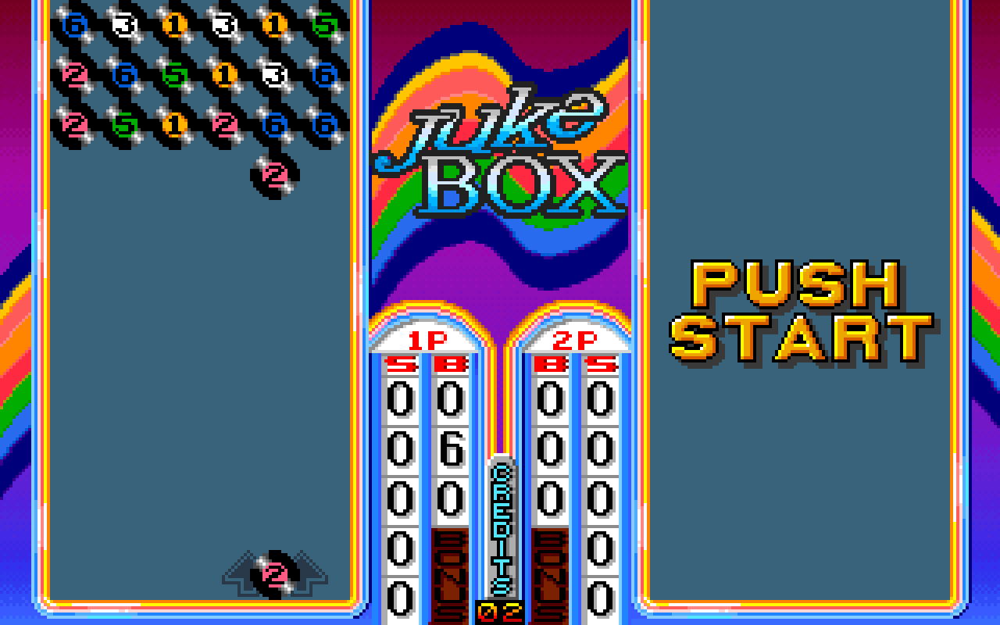

# LineUp: one script, two machines



*LineUp* (Eco-Games / GAMART, 1994) ran on an NEC V30 arcade board with an AY-3-8910, and its
team later ported the same source to MS-DOS. This demo plays it on the board under MAME with the
very script the DOSBox-X server plays the PC port with, `scry_core.games.lineup`: the same steps,
the same symbols, the same screen map, the same checks. Only a short binding differs per machine:
how it starts, which input is the coin, the screen's refresh, and the recording its sound is held
to. A script that needs anything more is a place where the two servers disagree.

It runs to the routine that draws the high scores by name, drops a coin and reads the credits the
game counted, starts a game, runs to the routine that writes its level, and plays: one column right,
the next colour, a shot, each read back off the player's own variables. Each screen it arrives at
is recognised off a map signed in palette indices, because the board's 5-bit palette and the PC's
6-bit DAC show the same pixels in slightly different colours. Then it records two seconds of the
stage's music off the AY-3-8910 and holds it, sample for sample, to `music.wav` beside this file.

## The romset

LineUp is not distributed with this repository. The demo needs its romset, `lineup.zip`, with the
linker's symbol map beside it, `lineup.map`, in one directory, and a MAME whose driver list
includes `lineup`.

## Run it

```sh
uv run python demos/lineup/demo.py --rompath /path/to/romset
```

- `--binary PATH` picks the MAME to start; left out, `MAME_BINARY`, else the `mame` on your
  `PATH`.
- The window opens in front, scaled to be seen.
- `--transcript PATH` moves the whole transcript; the run's other files go beside it.
- `--update-readme` rewrites the block below and `screen.png` from a run where every step passed.

Each line it prints is one call and its check. Exit codes: 0 every step passed, 1 a step failed,
2 a usage error, 3 nothing was demonstrated (a missing romset, a relative path, a server that did
not start).

## The prompt

Give this to an MCP client with this server connected:

> Start `lineup` with the romset directory (as an absolute path), its symbols from `lineup.map`
> there with DATA based at `0x400` and `LUP_JUKEBOX` read in place, checked against the image its
> two ROM halves make at `0x30000`. Load the screen map `scry_core/games/lineup.scry-map.json` from
> scry-core. Run to `Draw_High_Scores_Screen`
> counting `Check_Money25`, run a second and a half and tell me which screen it is and what
> `Credits` holds. Drop a coin, run a second, name the screen and read `Credits` again. Press
> START, run to `Level_Write`, run 200 ms, name the screen and read `Credits` and `Stage_Act`.
> Run three seconds, name the screen and read the first six words of `Player1`. Move right, take
> the next colour and shoot, letting the game run 200, 200 and 100 ms after each before reading
> `Player1`. Record two seconds of sound, measure it
> and compare it with `music.wav`, take a picture of the screen and close the session.

## What it walks

<!-- demo-transcript:begin -->
**1. `start`**: OK start: lineup on MAME, rom_check OK, 306 symbols

<details><summary>call and reply</summary>

```json
{
  "system": "lineup",
  "reference_rom": "./tmp/demos/lineup/lineup.ref",
  "reference_addr": "0x30000",
  "reference_base": "0x0",
  "symbols": "./tmp/demos/lineup/lineup.map",
  "bases": {
    "DATA": "0x400",
    "LUP_JUKEBOX": "rom"
  },
  "inipath": "./tmp/demos/lineup/lineup-ini",
  "state_dir": "./tmp/demos/lineup/lineup-states",
  "shared": true,
  "boot_seconds": 60,
  "rompath": "<host>"
}
```

```json
{
  "summary": "<volatile>",
  "status": "ok",
  "system": "lineup",
  "binary": "<volatile>",
  "binary_origin": "<volatile>",
  "version": "0.289 (unknown)",
  "pid": "<volatile>",
  "stub_port": "<volatile>",
  "scratch_dir": "<volatile>",
  "state_dir": "./tmp/demos/lineup/lineup-states",
  "cfg": {
    "available": false,
    "why": "no cfg was given, so MAME runs on its defaults"
  },
  "debugger": {
    "attached": "gdbstub",
    "note": "MAME runs with -debug under this stub. A capture taken at one of this session's stops can land a frame away from an autoboot golden taken by a frame notifier at the same count, in a scene that changes every frame: compare a live capture with a live golden"
  },
  "errorlog_path": "<volatile>",
  "stdout_path": "<volatile>",
  "rom_check": "OK",
  "symbols_total": 306,
  "symbols_format": "tsv",
  "symbols_by_class": {
    "DATA": 44,
    "CODE": 201,
    "LUP_JUKEBOX": 61
  },
  "symbols_by_cpu": {
    ":maincpu": 306
  },
  "registers": [
    "EAX",
    "ECX",
    "EDX",
    "EBX",
    "ESP",
    "EBP",
    "ESI",
    "EDI",
    "EIP",
    "EFLAGS",
    "CS",
    "SS",
    "DS",
    "ES",
    "FS",
    "GS",
    "ST0",
    "ST1",
    "ST2",
    "ST3",
    "ST4",
    "ST5",
    "ST6",
    "ST7",
    "FCTRL",
    "FSTAT",
    "FTAG",
    "FISEG",
    "FIOFF",
    "FOSEG",
    "FOOFF",
    "FOP"
  ],
  "pc": "0x000ffff0",
  "frame": 0,
  "frame_symbol": "frame",
  "view": "native",
  "views": [
    "Screen 0 Standard (4:3)",
    "Screen 0 Pixel Aspect (8:5)",
    "Cocktail"
  ],
  "background": false,
  "flags": "<volatile>",
  "boot_lua_path": "<volatile>",
  "presence": true,
  "machine": {
    "cpus": 1,
    "spaces": 2,
    "address_map": 7,
    "regions": 2,
    "shares": 0,
    "screens": 1,
    "rom_files": 3
  },
  "declarations": {
    "persistent": true,
    "path": "./tmp/demos/lineup/lineup-states/declarations.json",
    "key": "lineup ./tmp/demos/lineup/lineup.map",
    "held": 0,
    "fingerprint": "0ced5df101772f64",
    "rearm": {
      "rearmed": [],
      "stale": [],
      "unresolved": [],
      "unarmable": [],
      "evaluated": []
    },
    "comments": {
      "rearmed": [],
      "stale": [],
      "unresolved": [],
      "unarmable": []
    }
  },
  "recommended_release": "0.289",
  "session": {
    "alive": true,
    "running": false,
    "altered": false,
    "altering_writes": 0,
    "console": {
      "thread_errors": 0,
      "reruns": 0,
      "lost": 0
    }
  }
}
```

</details>

**2. `map_write`**: OK map: 4 screens and 10 controls loaded

<details><summary>call and reply</summary>

```json
{
  "method": "load",
  "path": "./tmp/demos/lineup/lineup.scry-map.json"
}
```

```json
{
  "summary": "map_write load: 4 screens, 10 controls of lineup",
  "status": "ok",
  "path": "./tmp/demos/lineup/lineup.scry-map.json",
  "application": "lineup",
  "screens": 4,
  "controls": 10,
  "session": {
    "alive": true,
    "running": false,
    "altered": false,
    "omitted": [
      "altering_writes",
      "console"
    ],
    "how": "call `status`"
  }
}
```

</details>

**3. `run_to`**: OK to the high scores: stopped at Draw_High_Scores_Screen

<details><summary>call and reply</summary>

```json
{
  "ref": "Draw_High_Scores_Screen",
  "control": "Check_Money25",
  "seconds": 120
}
```

```json
{
  "summary": "run_to Draw_High_Scores_Screen: TARGET, control counted 250",
  "status": "ok",
  "verdict": "TARGET",
  "control_hits": 250,
  "controls": [
    {
      "ref": "Check_Money25",
      "cpu": ":maincpu",
      "hits_in_run": 250
    }
  ],
  "cause": "target Draw_High_Scores_Screen",
  "stop_seq": 2,
  "pc": "0x000317e7",
  "cpu": ":maincpu",
  "frame": 253,
  "regs": {
    "EAX": "0x0500",
    "ECX": "0x0000",
    "EDX": "0x73ca",
    "EBX": "0x0000",
    "ESP": "0x99db",
    "EBP": "0xbe31",
    "ESI": "0x6992",
    "EDI": "0xfb28",
    "EIP": "0x000317e7",
    "EFLAGS": "0xf006",
    "CS": "0x3000",
    "SS": "0x0040",
    "DS": "0x0040",
    "ES": "0x1000",
    "FS": "0x00000000",
    "GS": "0x00000000",
    "ST0": "0x00000000000000000000",
    "ST1": "0x00000000000000000000",
    "ST2": "0x00000000000000000000",
    "ST3": "0x00000000000000000000",
    "ST4": "0x00000000000000000000",
    "ST5": "0x00000000000000000000",
    "ST6": "0x00000000000000000000",
    "ST7": "0x00000000000000000000",
    "FCTRL": "0x00000000",
    "FSTAT": "0x00000000",
    "FTAG": "0x00000000",
    "FISEG": "0x00000000",
    "FIOFF": "0x00000000",
    "FOSEG": "0x00000000",
    "FOOFF": "0x00000000",
    "FOP": "0x00000000"
  },
  "dasm": [
    "317E7: 1E       push    ds0",
    "317E8: E8 21 FE call    3160Ch",
    "317EB: B8 01 00 mov     aw,1h",
    "317EE: E8 29 73 call    38B1Ah",
    "317F1: E8 50 36 call    34E44h",
    "317F4: E8 8F FF call    31786h",
    "317F7: 1F       pop     ds0",
    "317F8: C3       ret     ",
    "317F9: 1E       push    ds0",
    "317FA: E8 0F FE call    3160Ch",
    "317FD: B8 00 00 mov     aw,0h",
    "31800: E8 17 73 call    38B1Ah",
    "31803: E8 80 FF call    31786h",
    "31806: 1F       pop     ds0"
  ],
  "errorlog": {
    "lines_total": 235,
    "truncated": true,
    "lines": [
      "[:maincpu] ':maincpu' (30514): unmapped io memory write to 000C = 0000 & FFFF",
      "[:maincpu] ':maincpu' (30514): unmapped io memory write to 000C = 0000 & FFFF",
      "[:maincpu] ':maincpu' (30514): unmapped io memory write to 000C = 0000 & FFFF",
      "[:maincpu] ':maincpu' (30514): unmapped io memory write to 000C = 0000 & FFFF",
      "[:maincpu] ':maincpu' (30514): unmapped io memory write to 000C = 0000 & FFFF",
      "[:maincpu] ':maincpu' (30514): unmapped io memory write to 000C = 0000 & FFFF",
      "[:maincpu] ':maincpu' (30514): unmapped io memory write to 000C = 0000 & FFFF",
      "[:maincpu] ':maincpu' (30514): unmapped io memory write to 000C = 0000 & FFFF"
    ],
    "mark": 14,
    "how": "`log(pattern=\".\", channel=\"emulator\", since_mark=14, limit=235)` reads them all"
  },
  "session": {
    "alive": true,
    "running": false,
    "altered": false,
    "omitted": [
      "altering_writes",
      "console"
    ],
    "how": "call `status`"
  }
}
```

</details>

**4. `run_for`**: OK drawn: the table drawn

<details><summary>call and reply</summary>

```json
{
  "milliseconds": 1500,
  "seconds": 120
}
```

```json
{
  "summary": "run_for 1500 ms: ELAPSED, frame 253 to 328",
  "status": "ok",
  "verdict": "ELAPSED",
  "frame_before": 253,
  "frame_after": 328,
  "emulated_before_s": 5.073958,
  "emulated_after_s": 6.57408,
  "cycles": 12000981,
  "reads": "<volatile>",
  "cause": "the console's `gtime` stop",
  "stop_seq": 3,
  "pc": "0x000315c4",
  "cpu": ":maincpu",
  "frame": 328,
  "regs": {
    "EAX": "0x7802",
    "ECX": "0x0000",
    "EDX": "0x73ca",
    "EBX": "0x0000",
    "ESP": "0x99d5",
    "EBP": "0xbe31",
    "ESI": "0x7200",
    "EDI": "0x1dac",
    "EIP": "0x000315c4",
    "EFLAGS": "0xf016",
    "CS": "0x3000",
    "SS": "0x0040",
    "DS": "0x7802",
    "ES": "0x1000",
    "FS": "0x00000000",
    "GS": "0x00000000",
    "ST0": "0x00000000000000000000",
    "ST1": "0x00000000000000000000",
    "ST2": "0x00000000000000000000",
    "ST3": "0x00000000000000000000",
    "ST4": "0x00000000000000000000",
    "ST5": "0x00000000000000000000",
    "ST6": "0x00000000000000000000",
    "ST7": "0x00000000000000000000",
    "FCTRL": "0x00000000",
    "FSTAT": "0x00000000",
    "FTAG": "0x00000000",
    "FISEG": "0x00000000",
    "FIOFF": "0x00000000",
    "FOSEG": "0x00000000",
    "FOOFF": "0x00000000",
    "FOP": "0x00000000"
  },
  "dasm": [
    "315C4: 59                pop     cw",
    "315C5: 81 C7 A8 00       add     iy,0A8h",
    "315C9: E2 F2             dbnz    315BDh",
    "315CB: 5E                pop     ix",
    "315CC: 1F                pop     ds0",
    "315CD: C3                ret     ",
    "315CE: 81 3E BA 8D 67 01 cmp     word ptr [8DBAh],167h",
    "315D4: 75 06             bne     315DCh",
    "315D6: C7 06 BA 8D 00 00 mov     word ptr [8DBAh],0h",
    "315DC: 8B 1E BA 8D       mov     bw,[8DBAh]",
    "315E0: D1 E3             shl     bw,1",
    "315E2: D1 E3             shl     bw,1"
  ],
  "errorlog": {
    "lines_total": 67,
    "truncated": true,
    "lines": [
      "[:maincpu] ':maincpu' (30514): unmapped io memory write to 000C = 0000 & FFFF",
      "[:maincpu] ':maincpu' (30514): unmapped io memory write to 000C = 0000 & FFFF",
      "[:maincpu] ':maincpu' (30514): unmapped io memory write to 000C = 0000 & FFFF",
      "[:maincpu] ':maincpu' (30514): unmapped io memory write to 000C = 0000 & FFFF",
      "[:maincpu] ':maincpu' (30514): unmapped io memory write to 000C = 0000 & FFFF",
      "[:maincpu] ':maincpu' (30514): unmapped io memory write to 000C = 0000 & FFFF",
      "[:maincpu] ':maincpu' (30514): unmapped io memory write to 000C = 0000 & FFFF",
      "[:maincpu] ':maincpu' (30514): unmapped io memory write to 000C = 0000 & FFFF"
    ],
    "mark": 18344,
    "how": "`log(pattern=\".\", channel=\"emulator\", since_mark=18344, limit=67)` reads them all"
  },
  "session": {
    "alive": true,
    "running": false,
    "altered": false,
    "omitted": [
      "altering_writes",
      "console"
    ],
    "how": "call `status`"
  }
}
```

</details>

**5. `map_find`**: OK is hiscores: the hiscores screen, its controls table, credits

<details><summary>call and reply</summary>

```json
{}
```

```json
{
  "summary": "map_find: hiscores (file), 2 controls",
  "status": "ok",
  "matched": true,
  "screen": "hiscores",
  "layer": "file",
  "kind": "pixel",
  "size": [
    320,
    200
  ],
  "controls": [
    {
      "name": "table",
      "rect": [
        64,
        30,
        192,
        145
      ],
      "centre": [
        160,
        102
      ]
    },
    {
      "name": "credits",
      "rect": [
        230,
        186,
        76,
        12
      ],
      "centre": [
        268,
        192
      ]
    }
  ],
  "evaluated_by": "one step",
  "lines_ahead": 0,
  "thread_errors": 0,
  "console_reruns": 0,
  "call": "MAME_MCP_LUA_END#1",
  "pc_before": "0x000315c4",
  "cause": "map_find: one step",
  "stop_seq": 4,
  "pc": "0x000315c5",
  "cpu": ":maincpu",
  "frame": 328,
  "regs": {
    "EAX": "0x7802",
    "ECX": "0x0001",
    "EDX": "0x73ca",
    "EBX": "0x0000",
    "ESP": "0x99d7",
    "EBP": "0xbe31",
    "ESI": "0x7200",
    "EDI": "0x1dac",
    "EIP": "0x000315c5",
    "EFLAGS": "0xf016",
    "CS": "0x3000",
    "SS": "0x0040",
    "DS": "0x7802",
    "ES": "0x1000",
    "FS": "0x00000000",
    "GS": "0x00000000",
    "ST0": "0x00000000000000000000",
    "ST1": "0x00000000000000000000",
    "ST2": "0x00000000000000000000",
    "ST3": "0x00000000000000000000",
    "ST4": "0x00000000000000000000",
    "ST5": "0x00000000000000000000",
    "ST6": "0x00000000000000000000",
    "ST7": "0x00000000000000000000",
    "FCTRL": "0x00000000",
    "FSTAT": "0x00000000",
    "FTAG": "0x00000000",
    "FISEG": "0x00000000",
    "FIOFF": "0x00000000",
    "FOSEG": "0x00000000",
    "FOOFF": "0x00000000",
    "FOP": "0x00000000"
  },
  "dasm": [
    "315C5: 81 C7 A8 00       add     iy,0A8h",
    "315C9: E2 F2             dbnz    315BDh",
    "315CB: 5E                pop     ix",
    "315CC: 1F                pop     ds0",
    "315CD: C3                ret     ",
    "315CE: 81 3E BA 8D 67 01 cmp     word ptr [8DBAh],167h",
    "315D4: 75 06             bne     315DCh",
    "315D6: C7 06 BA 8D 00 00 mov     word ptr [8DBAh],0h",
    "315DC: 8B 1E BA 8D       mov     bw,[8DBAh]",
    "315E0: D1 E3             shl     bw,1",
    "315E2: D1 E3             shl     bw,1",
    "315E4: 81 C3 4C 3C       add     bw,3C4Ch"
  ],
  "errorlog": {
    "lines_total": 0,
    "truncated": false,
    "lines": [],
    "mark": 23570
  },
  "session": {
    "alive": true,
    "running": false,
    "altered": false,
    "omitted": [
      "altering_writes",
      "console"
    ],
    "how": "call `status`"
  }
}
```

</details>

**6. `read_memory`**: OK no credits: Credits holds 0

<details><summary>call and reply</summary>

```json
{
  "ref": "Credits",
  "length": 2
}
```

```json
{
  "summary": "read_memory Credits: 2 bytes at 0x0000914a: 0000",
  "status": "ok",
  "addr": "0x0000914a",
  "length": 2,
  "hex": "0000",
  "cpu": ":maincpu",
  "session": {
    "alive": true,
    "running": false,
    "altered": false,
    "omitted": [
      "altering_writes",
      "console"
    ],
    "how": "call `status`"
  }
}
```

</details>

**7. `input`**: OK press coin: COIN pressed

<details><summary>call and reply</summary>

```json
{
  "port": ":P1",
  "field": "Coin 1",
  "frames": 4
}
```

```json
{
  "summary": "input :P1 'Coin 1': held 4 frames, active True, released at frame 332",
  "status": "ok",
  "verdict": "ELAPSED",
  "frame_before": 328,
  "frame_after": 333,
  "cycles": 761861,
  "polls": 5,
  "lines_ahead": 0,
  "thread_errors": 0,
  "console_reruns": 0,
  "route": "ioport",
  "port": ":P1",
  "field": "Coin 1",
  "value": "0x00000001",
  "frames": 4,
  "name": "Coin 1",
  "player": 0,
  "mask": "0x00000001",
  "defvalue": "0x00000001",
  "port_before": "0x000000ff",
  "frame_set": 328,
  "released": true,
  "port_held": "0x000000fe",
  "frame_released": 332,
  "active": true,
  "cause": "the `gvblank` stop of the last frame asked",
  "stop_seq": 5,
  "pc": "0x000300ad",
  "cpu": ":maincpu",
  "frame": 333,
  "regs": {
    "EAX": "0x7000",
    "ECX": "0x0000",
    "EDX": "0x73ca",
    "EBX": "0x05a2",
    "ESP": "0x99d3",
    "EBP": "0xbe31",
    "ESI": "0x8db6",
    "EDI": "0x89db",
    "EIP": "0x000300ad",
    "EFLAGS": "0xf046",
    "CS": "0x3000",
    "SS": "0x0040",
    "DS": "0x0040",
    "ES": "0x1000",
    "FS": "0x00000000",
    "GS": "0x00000000",
    "ST0": "0x00000000000000000000",
    "ST1": "0x00000000000000000000",
    "ST2": "0x00000000000000000000",
    "ST3": "0x00000000000000000000",
    "ST4": "0x00000000000000000000",
    "ST5": "0x00000000000000000000",
    "ST6": "0x00000000000000000000",
    "ST7": "0x00000000000000000000",
    "FCTRL": "0x00000000",
    "FSTAT": "0x00000000",
    "FTAG": "0x00000000",
    "FISEG": "0x00000000",
    "FIOFF": "0x00000000",
    "FOSEG": "0x00000000",
    "FOOFF": "0x00000000",
    "FOP": "0x00000000"
  },
  "dasm": [
    "300AD: 55             push    bp",
    "300AE: 50             push    aw",
    "300AF: 53             push    bw",
    "300B0: 51             push    cw",
    "300B1: 52             push    dw",
    "300B2: 56             push    ix",
    "300B3: 57             push    iy",
    "300B4: 1E             push    ds0",
    "300B5: 06             push    ds1",
    "300B6: 9C             push    psw",
    "300B7: B8 40 00       mov     aw,40h",
    "300BA: 8E D8          mov     ds0,aw",
    "300BC: B8 00 10       mov     aw,1000h",
    "300BF: 8E C0          mov     ds1,aw",
    "300C1: FC             clr1    dir",
    "300C2: 83 3E C8 8D 01 cmp     word ptr [8DC8h],1h",
    "300C7: 75 0B          bne     300D4h",
    "300C9: 9D             pop     psw",
    "300CA: 07             pop     ds1",
    "300CB: 1F             pop     ds0",
    "300CC: 5F             pop     iy"
  ],
  "errorlog": {
    "lines_total": 8,
    "truncated": false,
    "lines": [
      "[luaengine] MAME_MCP_INPUT#2 set name=\"Coin 1\" player=0 mask=00000001 defvalue=00000001 port_before=000000ff frame=328",
      "",
      "[:maincpu] ':maincpu' (30514): unmapped io memory write to 000C = 0000 & FFFF",
      "[:maincpu] ':maincpu' (30514): unmapped io memory write to 000C = 0000 & FFFF",
      "[:maincpu] ':maincpu' (30514): unmapped io memory write to 000C = 0000 & FFFF",
      "[luaengine] MAME_MCP_INPUT#2 release frame=332 port_held=000000fe",
      "",
      "[:maincpu] ':maincpu' (30514): unmapped io memory write to 000C = 0000 & FFFF"
    ],
    "mark": 23570
  },
  "session": {
    "alive": true,
    "running": false,
    "altered": false,
    "omitted": [
      "altering_writes",
      "console"
    ],
    "how": "call `status`"
  }
}
```

</details>

**8. `run_for`**: OK counted: the coin counted

<details><summary>call and reply</summary>

```json
{
  "milliseconds": 1000,
  "seconds": 120
}
```

```json
{
  "summary": "run_for 1000 ms: ELAPSED, frame 333 to 383",
  "status": "ok",
  "verdict": "ELAPSED",
  "frame_before": 333,
  "frame_after": 383,
  "emulated_before_s": 6.669314,
  "emulated_after_s": 7.669315,
  "cycles": 8000009,
  "reads": "<volatile>",
  "cause": "the console's `gtime` stop",
  "stop_seq": 6,
  "pc": "0x0003143e",
  "cpu": ":maincpu",
  "frame": 383,
  "regs": {
    "EAX": "0x1000",
    "ECX": "0x0000",
    "EDX": "0x0002",
    "EBX": "0xbe0b",
    "ESP": "0x99bd",
    "EBP": "0xbe31",
    "ESI": "0x87ac",
    "EDI": "0xbf99",
    "EIP": "0x0003143e",
    "EFLAGS": "0xf046",
    "CS": "0x3000",
    "SS": "0x0040",
    "DS": "0x0040",
    "ES": "0x1000",
    "FS": "0x00000000",
    "GS": "0x00000000",
    "ST0": "0x00000000000000000000",
    "ST1": "0x00000000000000000000",
    "ST2": "0x00000000000000000000",
    "ST3": "0x00000000000000000000",
    "ST4": "0x00000000000000000000",
    "ST5": "0x00000000000000000000",
    "ST6": "0x00000000000000000000",
    "ST7": "0x00000000000000000000",
    "FCTRL": "0x00000000",
    "FSTAT": "0x00000000",
    "FTAG": "0x00000000",
    "FISEG": "0x00000000",
    "FIOFF": "0x00000000",
    "FOSEG": "0x00000000",
    "FOOFF": "0x00000000",
    "FOP": "0x00000000"
  },
  "dasm": [
    "3143E: C3                ret     ",
    "3143F: B8 40 00          mov     aw,40h",
    "31442: 8E D8             mov     ds0,aw",
    "31444: B8 00 10          mov     aw,1000h",
    "31447: 8E C0             mov     ds1,aw",
    "31449: 83 3E 4E 8D 00    cmp     word ptr [8D4Eh],0h",
    "3144E: 74 09             be      31459h",
    "31450: F7 06 A0 82 01 00 test    word ptr [82A0h],1h",
    "31456: 74 10             be      31468h",
    "31458: C3                ret     ",
    "31459: F7 06 A0 82 01 00 test    word ptr [82A0h],1h"
  ],
  "errorlog": {
    "lines_total": 51,
    "truncated": true,
    "lines": [
      "[:maincpu] ':maincpu' (30514): unmapped io memory write to 000C = 0000 & FFFF",
      "[:maincpu] ':maincpu' (30514): unmapped io memory write to 000C = 0000 & FFFF",
      "[:maincpu] ':maincpu' (30514): unmapped io memory write to 000C = 0000 & FFFF",
      "[:maincpu] ':maincpu' (30514): unmapped io memory write to 000C = 0000 & FFFF",
      "[:maincpu] ':maincpu' (30514): unmapped io memory write to 000C = 0000 & FFFF",
      "[:maincpu] ':maincpu' (30514): unmapped io memory write to 000C = 0000 & FFFF",
      "[:maincpu] ':maincpu' (30514): unmapped io memory write to 000C = 0000 & FFFF",
      "[:maincpu] ':maincpu' (30514): unmapped io memory write to 000C = 0000 & FFFF"
    ],
    "mark": 24069,
    "how": "`log(pattern=\".\", channel=\"emulator\", since_mark=24069, limit=51)` reads them all"
  },
  "session": {
    "alive": true,
    "running": false,
    "altered": false,
    "omitted": [
      "altering_writes",
      "console"
    ],
    "how": "call `status`"
  }
}
```

</details>

**9. `map_find`**: OK is insert: the insert screen, its controls banner, credits

<details><summary>call and reply</summary>

```json
{}
```

```json
{
  "summary": "map_find: insert (file), 2 controls",
  "status": "ok",
  "matched": true,
  "screen": "insert",
  "layer": "file",
  "kind": "pixel",
  "size": [
    320,
    200
  ],
  "controls": [
    {
      "name": "banner",
      "rect": [
        0,
        6,
        320,
        22
      ],
      "centre": [
        160,
        17
      ]
    },
    {
      "name": "credits",
      "rect": [
        230,
        186,
        76,
        12
      ],
      "centre": [
        268,
        192
      ]
    }
  ],
  "evaluated_by": "one step",
  "lines_ahead": 0,
  "thread_errors": 0,
  "console_reruns": 0,
  "call": "MAME_MCP_LUA_END#3",
  "pc_before": "0x0003143e",
  "cause": "map_find: one step",
  "stop_seq": 7,
  "pc": "0x000300e9",
  "cpu": ":maincpu",
  "frame": 383,
  "regs": {
    "EAX": "0x1000",
    "ECX": "0x0000",
    "EDX": "0x0002",
    "EBX": "0xbe0b",
    "ESP": "0x99bf",
    "EBP": "0xbe31",
    "ESI": "0x87ac",
    "EDI": "0xbf99",
    "EIP": "0x000300e9",
    "EFLAGS": "0xf046",
    "CS": "0x3000",
    "SS": "0x0040",
    "DS": "0x0040",
    "ES": "0x1000",
    "FS": "0x00000000",
    "GS": "0x00000000",
    "ST0": "0x00000000000000000000",
    "ST1": "0x00000000000000000000",
    "ST2": "0x00000000000000000000",
    "ST3": "0x00000000000000000000",
    "ST4": "0x00000000000000000000",
    "ST5": "0x00000000000000000000",
    "ST6": "0x00000000000000000000",
    "ST7": "0x00000000000000000000",
    "FCTRL": "0x00000000",
    "FSTAT": "0x00000000",
    "FTAG": "0x00000000",
    "FISEG": "0x00000000",
    "FIOFF": "0x00000000",
    "FOSEG": "0x00000000",
    "FOOFF": "0x00000000",
    "FOP": "0x00000000"
  },
  "dasm": [
    "300E9: E8 53 13       call    3143Fh",
    "300EC: 83 3E 46 8D 01 cmp     word ptr [8D46h],1h",
    "300F1: 75 02          bne     300F5h",
    "300F3: EB 6E          br      30163h",
    "300F5: E8 3D 03       call    30435h",
    "300F8: BE 00 80       mov     ix,8000h",
    "300FB: F7 04 01 00    test    word ptr [ix],1h",
    "300FF: 74 0F          be      30110h",
    "30101: F7 04 3C 00    test    word ptr [ix],3Ch",
    "30105: 75 09          bne     30110h",
    "30107: E8 3D 0C       call    30D47h"
  ],
  "errorlog": {
    "lines_total": 0,
    "truncated": false,
    "lines": [],
    "mark": 28047
  },
  "session": {
    "alive": true,
    "running": false,
    "altered": false,
    "omitted": [
      "altering_writes",
      "console"
    ],
    "how": "call `status`"
  }
}
```

</details>

**10. `read_memory`**: OK credits: Credits holds 3

<details><summary>call and reply</summary>

```json
{
  "ref": "Credits",
  "length": 2
}
```

```json
{
  "summary": "read_memory Credits: 2 bytes at 0x0000914a: 0300",
  "status": "ok",
  "addr": "0x0000914a",
  "length": 2,
  "hex": "0300",
  "cpu": ":maincpu",
  "session": {
    "alive": true,
    "running": false,
    "altered": false,
    "omitted": [
      "altering_writes",
      "console"
    ],
    "how": "call `status`"
  }
}
```

</details>

**11. `input`**: OK press start: START pressed

<details><summary>call and reply</summary>

```json
{
  "port": ":P1",
  "field": "1 Player Start",
  "frames": 4
}
```

```json
{
  "summary": "input :P1 '1 Player Start': held 4 frames, active True, released at frame 387",
  "status": "ok",
  "verdict": "ELAPSED",
  "frame_before": 383,
  "frame_after": 388,
  "cycles": 785886,
  "polls": 5,
  "lines_ahead": 0,
  "thread_errors": 0,
  "console_reruns": 0,
  "route": "ioport",
  "port": ":P1",
  "field": "1 Player Start",
  "value": "0x00000001",
  "frames": 4,
  "name": "1 Player Start",
  "player": 0,
  "mask": "0x00000002",
  "defvalue": "0x00000002",
  "port_before": "0x000000ff",
  "frame_set": 383,
  "released": true,
  "port_held": "0x000000fd",
  "frame_released": 387,
  "active": true,
  "cause": "the `gvblank` stop of the last frame asked",
  "stop_seq": 8,
  "pc": "0x000300ad",
  "cpu": ":maincpu",
  "frame": 388,
  "regs": {
    "EAX": "0x0000",
    "ECX": "0x009b",
    "EDX": "0x73ca",
    "EBX": "0xc440",
    "ESP": "0x99c9",
    "EBP": "0xbe31",
    "ESI": "0xbe10",
    "EDI": "0x348a",
    "EIP": "0x000300ad",
    "EFLAGS": "0xf082",
    "CS": "0x3000",
    "SS": "0x0040",
    "DS": "0x0040",
    "ES": "0x1000",
    "FS": "0x00000000",
    "GS": "0x00000000",
    "ST0": "0x00000000000000000000",
    "ST1": "0x00000000000000000000",
    "ST2": "0x00000000000000000000",
    "ST3": "0x00000000000000000000",
    "ST4": "0x00000000000000000000",
    "ST5": "0x00000000000000000000",
    "ST6": "0x00000000000000000000",
    "ST7": "0x00000000000000000000",
    "FCTRL": "0x00000000",
    "FSTAT": "0x00000000",
    "FTAG": "0x00000000",
    "FISEG": "0x00000000",
    "FIOFF": "0x00000000",
    "FOSEG": "0x00000000",
    "FOOFF": "0x00000000",
    "FOP": "0x00000000"
  },
  "dasm": [
    "300AD: 55             push    bp",
    "300AE: 50             push    aw",
    "300AF: 53             push    bw",
    "300B0: 51             push    cw",
    "300B1: 52             push    dw",
    "300B2: 56             push    ix",
    "300B3: 57             push    iy",
    "300B4: 1E             push    ds0",
    "300B5: 06             push    ds1",
    "300B6: 9C             push    psw",
    "300B7: B8 40 00       mov     aw,40h",
    "300BA: 8E D8          mov     ds0,aw",
    "300BC: B8 00 10       mov     aw,1000h",
    "300BF: 8E C0          mov     ds1,aw",
    "300C1: FC             clr1    dir",
    "300C2: 83 3E C8 8D 01 cmp     word ptr [8DC8h],1h",
    "300C7: 75 0B          bne     300D4h",
    "300C9: 9D             pop     psw",
    "300CA: 07             pop     ds1",
    "300CB: 1F             pop     ds0",
    "300CC: 5F             pop     iy"
  ],
  "errorlog": {
    "lines_total": 5,
    "truncated": false,
    "lines": [
      "[luaengine] MAME_MCP_INPUT#4 set name=\"1 Player Start\" player=0 mask=00000002 defvalue=00000002 port_before=000000ff frame=383",
      "",
      "[:maincpu] ':maincpu' (30514): unmapped io memory write to 000C = 0000 & FFFF",
      "[luaengine] MAME_MCP_INPUT#4 release frame=387 port_held=000000fd",
      ""
    ],
    "mark": 28047
  },
  "session": {
    "alive": true,
    "running": false,
    "altered": false,
    "omitted": [
      "altering_writes",
      "console"
    ],
    "how": "call `status`"
  }
}
```

</details>

**12. `run_to`**: OK to the level: stopped at Level_Write

<details><summary>call and reply</summary>

```json
{
  "ref": "Level_Write",
  "control": "Check_Money25",
  "seconds": 120
}
```

```json
{
  "summary": "run_to Level_Write: TARGET, control counted 180",
  "status": "ok",
  "verdict": "TARGET",
  "control_hits": 180,
  "controls": [
    {
      "ref": "Check_Money25",
      "cpu": ":maincpu",
      "hits_in_run": 180
    }
  ],
  "cause": "target Level_Write",
  "stop_seq": 9,
  "pc": "0x000343b8",
  "cpu": ":maincpu",
  "frame": 567,
  "regs": {
    "EAX": "0x1000",
    "ECX": "0x0000",
    "EDX": "0x0002",
    "EBX": "0x43b8",
    "ESP": "0x99d9",
    "EBP": "0xbe31",
    "ESI": "0x8000",
    "EDI": "0xfaa0",
    "EIP": "0x000343b8",
    "EFLAGS": "0xf006",
    "CS": "0x3000",
    "SS": "0x0040",
    "DS": "0x0040",
    "ES": "0x1000",
    "FS": "0x00000000",
    "GS": "0x00000000",
    "ST0": "0x00000000000000000000",
    "ST1": "0x00000000000000000000",
    "ST2": "0x00000000000000000000",
    "ST3": "0x00000000000000000000",
    "ST4": "0x00000000000000000000",
    "ST5": "0x00000000000000000000",
    "ST6": "0x00000000000000000000",
    "ST7": "0x00000000000000000000",
    "FCTRL": "0x00000000",
    "FSTAT": "0x00000000",
    "FTAG": "0x00000000",
    "FISEG": "0x00000000",
    "FIOFF": "0x00000000",
    "FOSEG": "0x00000000",
    "FOOFF": "0x00000000",
    "FOP": "0x00000000"
  },
  "dasm": [
    "343B8: BB 88 34    mov     bw,3488h",
    "343BB: 8B 7C 34    mov     iy,[ix+34h]",
    "343BE: E8 8E 07    call    34B4Fh",
    "343C1: 8B 44 2E    mov     aw,[ix+2Eh]",
    "343C4: 3D 04 00    cmp     aw,4h",
    "343C7: 72 05       bc      343CEh",
    "343C9: 2D 03 00    sub     aw,3h",
    "343CC: EB F6       br      343C4h",
    "343CE: B9 01 00    mov     cw,1h",
    "343D1: 8B 7C 34    mov     iy,[ix+34h]",
    "343D4: 81 C7 24 1E add     iy,1E24h"
  ],
  "errorlog": {
    "lines_total": 3,
    "truncated": false,
    "lines": [
      "[:maincpu] ':maincpu' (30514): unmapped io memory write to 000C = 0000 & FFFF",
      "[:maincpu] ':maincpu' (30514): unmapped io memory write to 000C = 0000 & FFFF",
      "[:maincpu] ':maincpu' (30514): unmapped io memory write to 000C = 0000 & FFFF"
    ],
    "mark": 28320
  },
  "session": {
    "alive": true,
    "running": false,
    "altered": false,
    "omitted": [
      "altering_writes",
      "console"
    ],
    "how": "call `status`"
  }
}
```

</details>

**13. `run_for`**: OK level shown: LEVEL 1 written

<details><summary>call and reply</summary>

```json
{
  "milliseconds": 200,
  "seconds": 120
}
```

```json
{
  "summary": "run_for 200 ms: ELAPSED, frame 567 to 577",
  "status": "ok",
  "verdict": "ELAPSED",
  "frame_before": 567,
  "frame_after": 577,
  "emulated_before_s": 11.342635,
  "emulated_after_s": 11.542635,
  "cycles": 1600004,
  "reads": "<volatile>",
  "cause": "the console's `gtime` stop",
  "stop_seq": 10,
  "pc": "0x00034b9e",
  "cpu": ":maincpu",
  "frame": 577,
  "regs": {
    "EAX": "0x8183",
    "ECX": "0x0038",
    "EDX": "0x0018",
    "EBX": "0x1680",
    "ESP": "0x99d1",
    "EBP": "0xbe31",
    "ESI": "0x1684",
    "EDI": "0x78f8",
    "EIP": "0x00034b9e",
    "EFLAGS": "0xf006",
    "CS": "0x3000",
    "SS": "0x0040",
    "DS": "0x81a2",
    "ES": "0x1000",
    "FS": "0x00000000",
    "GS": "0x00000000",
    "ST0": "0x00000000000000000000",
    "ST1": "0x00000000000000000000",
    "ST2": "0x00000000000000000000",
    "ST3": "0x00000000000000000000",
    "ST4": "0x00000000000000000000",
    "ST5": "0x00000000000000000000",
    "ST6": "0x00000000000000000000",
    "ST7": "0x00000000000000000000",
    "FCTRL": "0x00000000",
    "FSTAT": "0x00000000",
    "FTAG": "0x00000000",
    "FISEG": "0x00000000",
    "FIOFF": "0x00000000",
    "FOSEG": "0x00000000",
    "FOOFF": "0x00000000",
    "FOP": "0x00000000"
  },
  "dasm": [
    "34B9E: B0 83       mov     al,83h",
    "34BA0: AA          stmb    ",
    "34BA1: E2 FB       dbnz    34B9Eh",
    "34BA3: 5F          pop     iy",
    "34BA4: 81 C7 40 01 add     iy,140h",
    "34BA8: 4A          dec     dw",
    "34BA9: 75 F0       bne     34B9Bh",
    "34BAB: 5E          pop     ix",
    "34BAC: 1F          pop     ds0",
    "34BAD: 07          pop     ds1",
    "34BAE: C3          ret     ",
    "34BAF: 1E          push    ds0",
    "34BB0: 56          push    ix",
    "34BB1: 50          push    aw",
    "34BB2: BA A2 81    mov     dw,81A2h",
    "34BB5: 8E DA       mov     ds0,dw",
    "34BB7: 8B D9       mov     bw,cw",
    "34BB9: D1 E3       shl     bw,1",
    "34BBB: 81 C3 60 49 add     bw,4960h"
  ],
  "errorlog": {
    "lines_total": 0,
    "truncated": false,
    "lines": [],
    "mark": 28554
  },
  "session": {
    "alive": true,
    "running": false,
    "altered": false,
    "omitted": [
      "altering_writes",
      "console"
    ],
    "how": "call `status`"
  }
}
```

</details>

**14. `map_find`**: OK is level: the level screen, its controls p1_well, p2_well, credits

<details><summary>call and reply</summary>

```json
{}
```

```json
{
  "summary": "map_find: level (file), 3 controls",
  "status": "ok",
  "matched": true,
  "screen": "level",
  "layer": "file",
  "kind": "pixel",
  "size": [
    320,
    200
  ],
  "controls": [
    {
      "name": "p1_well",
      "rect": [
        15,
        0,
        98,
        194
      ],
      "centre": [
        64,
        97
      ]
    },
    {
      "name": "p2_well",
      "rect": [
        207,
        0,
        98,
        194
      ],
      "centre": [
        256,
        97
      ]
    },
    {
      "name": "credits",
      "rect": [
        152,
        190,
        16,
        10
      ],
      "centre": [
        160,
        195
      ]
    }
  ],
  "evaluated_by": "one step",
  "lines_ahead": 0,
  "thread_errors": 0,
  "console_reruns": 0,
  "call": "MAME_MCP_LUA_END#5",
  "pc_before": "0x00034b9e",
  "cause": "map_find: one step",
  "stop_seq": 11,
  "pc": "0x00034ba0",
  "cpu": ":maincpu",
  "frame": 577,
  "regs": {
    "EAX": "0x8183",
    "ECX": "0x0038",
    "EDX": "0x0018",
    "EBX": "0x1680",
    "ESP": "0x99d1",
    "EBP": "0xbe31",
    "ESI": "0x1684",
    "EDI": "0x78f8",
    "EIP": "0x00034ba0",
    "EFLAGS": "0xf006",
    "CS": "0x3000",
    "SS": "0x0040",
    "DS": "0x81a2",
    "ES": "0x1000",
    "FS": "0x00000000",
    "GS": "0x00000000",
    "ST0": "0x00000000000000000000",
    "ST1": "0x00000000000000000000",
    "ST2": "0x00000000000000000000",
    "ST3": "0x00000000000000000000",
    "ST4": "0x00000000000000000000",
    "ST5": "0x00000000000000000000",
    "ST6": "0x00000000000000000000",
    "ST7": "0x00000000000000000000",
    "FCTRL": "0x00000000",
    "FSTAT": "0x00000000",
    "FTAG": "0x00000000",
    "FISEG": "0x00000000",
    "FIOFF": "0x00000000",
    "FOSEG": "0x00000000",
    "FOOFF": "0x00000000",
    "FOP": "0x00000000"
  },
  "dasm": [
    "34BA0: AA          stmb    ",
    "34BA1: E2 FB       dbnz    34B9Eh",
    "34BA3: 5F          pop     iy",
    "34BA4: 81 C7 40 01 add     iy,140h",
    "34BA8: 4A          dec     dw",
    "34BA9: 75 F0       bne     34B9Bh",
    "34BAB: 5E          pop     ix",
    "34BAC: 1F          pop     ds0",
    "34BAD: 07          pop     ds1",
    "34BAE: C3          ret     ",
    "34BAF: 1E          push    ds0",
    "34BB0: 56          push    ix",
    "34BB1: 50          push    aw",
    "34BB2: BA A2 81    mov     dw,81A2h",
    "34BB5: 8E DA       mov     ds0,dw",
    "34BB7: 8B D9       mov     bw,cw",
    "34BB9: D1 E3       shl     bw,1",
    "34BBB: 81 C3 60 49 add     bw,4960h",
    "34BBF: 33 D2       xor     dw,dw"
  ],
  "errorlog": {
    "lines_total": 0,
    "truncated": false,
    "lines": [],
    "mark": 28554
  },
  "session": {
    "alive": true,
    "running": false,
    "altered": false,
    "omitted": [
      "altering_writes",
      "console"
    ],
    "how": "call `status`"
  }
}
```

</details>

**15. `read_memory`**: OK one spent: Credits holds 2

<details><summary>call and reply</summary>

```json
{
  "ref": "Credits",
  "length": 2
}
```

```json
{
  "summary": "read_memory Credits: 2 bytes at 0x0000914a: 0200",
  "status": "ok",
  "addr": "0x0000914a",
  "length": 2,
  "hex": "0200",
  "cpu": ":maincpu",
  "session": {
    "alive": true,
    "running": false,
    "altered": false,
    "omitted": [
      "altering_writes",
      "console"
    ],
    "how": "call `status`"
  }
}
```

</details>

**16. `read_memory`**: OK first stage: Stage_Act holds 0

<details><summary>call and reply</summary>

```json
{
  "ref": "Stage_Act",
  "length": 2
}
```

```json
{
  "summary": "read_memory Stage_Act: 2 bytes at 0x000086a6: 0000",
  "status": "ok",
  "addr": "0x000086a6",
  "length": 2,
  "hex": "0000",
  "cpu": ":maincpu",
  "session": {
    "alive": true,
    "running": false,
    "altered": false,
    "omitted": [
      "altering_writes",
      "console"
    ],
    "how": "call `status`"
  }
}
```

</details>

**17. `run_for`**: OK play: the board filled

<details><summary>call and reply</summary>

```json
{
  "milliseconds": 3000,
  "seconds": 120
}
```

```json
{
  "summary": "run_for 3000 ms: ELAPSED, frame 577 to 727",
  "status": "ok",
  "verdict": "ELAPSED",
  "frame_before": 577,
  "frame_after": 727,
  "emulated_before_s": 11.542636,
  "emulated_after_s": 14.542637,
  "cycles": 24000008,
  "reads": "<volatile>",
  "cause": "the console's `gtime` stop",
  "stop_seq": 12,
  "pc": "0x0003063a",
  "cpu": ":maincpu",
  "frame": 727,
  "regs": {
    "EAX": "0x6182",
    "ECX": "0x0000",
    "EDX": "0x0a01",
    "EBX": "0x80a6",
    "ESP": "0x99b7",
    "EBP": "0xbe31",
    "ESI": "0x06aa",
    "EDI": "0x20ea",
    "EIP": "0x0003063a",
    "EFLAGS": "0xf002",
    "CS": "0x3000",
    "SS": "0x0040",
    "DS": "0x6182",
    "ES": "0x1000",
    "FS": "0x00000000",
    "GS": "0x00000000",
    "ST0": "0x00000000000000000000",
    "ST1": "0x00000000000000000000",
    "ST2": "0x00000000000000000000",
    "ST3": "0x00000000000000000000",
    "ST4": "0x00000000000000000000",
    "ST5": "0x00000000000000000000",
    "ST6": "0x00000000000000000000",
    "ST7": "0x00000000000000000000",
    "FCTRL": "0x00000000",
    "FSTAT": "0x00000000",
    "FTAG": "0x00000000",
    "FISEG": "0x00000000",
    "FIOFF": "0x00000000",
    "FOSEG": "0x00000000",
    "FOOFF": "0x00000000",
    "FOP": "0x00000000"
  },
  "dasm": [
    "3063A: A5          movbkw  ",
    "3063B: A5          movbkw  ",
    "3063C: A5          movbkw  ",
    "3063D: 81 C7 30 01 add     iy,130h",
    "30641: A5          movbkw  ",
    "30642: A5          movbkw  ",
    "30643: A5          movbkw  ",
    "30644: A5          movbkw  ",
    "30645: A5          movbkw  ",
    "30646: A5          movbkw  ",
    "30647: A5          movbkw  ",
    "30648: A5          movbkw  ",
    "30649: 81 C7 30 01 add     iy,130h",
    "3064D: A5          movbkw  ",
    "3064E: A5          movbkw  ",
    "3064F: A5          movbkw  ",
    "30650: A5          movbkw  ",
    "30651: A5          movbkw  ",
    "30652: A5          movbkw  ",
    "30653: A5          movbkw  ",
    "30654: A5          movbkw  ",
    "30655: 81 C7 30 01 add     iy,130h",
    "30659: A5          movbkw  "
  ],
  "errorlog": {
    "lines_total": 0,
    "truncated": false,
    "lines": [],
    "mark": 28554
  },
  "session": {
    "alive": true,
    "running": false,
    "altered": false,
    "omitted": [
      "altering_writes",
      "console"
    ],
    "how": "call `status`"
  }
}
```

</details>

**18. `map_find`**: OK is play: the play screen, its controls p1_well, p2_well, credits

<details><summary>call and reply</summary>

```json
{}
```

```json
{
  "summary": "map_find: play (file), 3 controls",
  "status": "ok",
  "matched": true,
  "screen": "play",
  "layer": "file",
  "kind": "pixel",
  "size": [
    320,
    200
  ],
  "controls": [
    {
      "name": "p1_well",
      "rect": [
        15,
        0,
        98,
        194
      ],
      "centre": [
        64,
        97
      ]
    },
    {
      "name": "p2_well",
      "rect": [
        207,
        0,
        98,
        194
      ],
      "centre": [
        256,
        97
      ]
    },
    {
      "name": "credits",
      "rect": [
        152,
        190,
        16,
        10
      ],
      "centre": [
        160,
        195
      ]
    }
  ],
  "evaluated_by": "one step",
  "lines_ahead": 0,
  "thread_errors": 0,
  "console_reruns": 0,
  "call": "MAME_MCP_LUA_END#6",
  "pc_before": "0x0003063a",
  "cause": "map_find: one step",
  "stop_seq": 13,
  "pc": "0x0003063b",
  "cpu": ":maincpu",
  "frame": 727,
  "regs": {
    "EAX": "0x6182",
    "ECX": "0x0000",
    "EDX": "0x0a01",
    "EBX": "0x80a6",
    "ESP": "0x99b7",
    "EBP": "0xbe31",
    "ESI": "0x06ac",
    "EDI": "0x20ec",
    "EIP": "0x0003063b",
    "EFLAGS": "0xf002",
    "CS": "0x3000",
    "SS": "0x0040",
    "DS": "0x6182",
    "ES": "0x1000",
    "FS": "0x00000000",
    "GS": "0x00000000",
    "ST0": "0x00000000000000000000",
    "ST1": "0x00000000000000000000",
    "ST2": "0x00000000000000000000",
    "ST3": "0x00000000000000000000",
    "ST4": "0x00000000000000000000",
    "ST5": "0x00000000000000000000",
    "ST6": "0x00000000000000000000",
    "ST7": "0x00000000000000000000",
    "FCTRL": "0x00000000",
    "FSTAT": "0x00000000",
    "FTAG": "0x00000000",
    "FISEG": "0x00000000",
    "FIOFF": "0x00000000",
    "FOSEG": "0x00000000",
    "FOOFF": "0x00000000",
    "FOP": "0x00000000"
  },
  "dasm": [
    "3063B: A5          movbkw  ",
    "3063C: A5          movbkw  ",
    "3063D: 81 C7 30 01 add     iy,130h",
    "30641: A5          movbkw  ",
    "30642: A5          movbkw  ",
    "30643: A5          movbkw  ",
    "30644: A5          movbkw  ",
    "30645: A5          movbkw  ",
    "30646: A5          movbkw  ",
    "30647: A5          movbkw  ",
    "30648: A5          movbkw  ",
    "30649: 81 C7 30 01 add     iy,130h",
    "3064D: A5          movbkw  ",
    "3064E: A5          movbkw  ",
    "3064F: A5          movbkw  ",
    "30650: A5          movbkw  ",
    "30651: A5          movbkw  ",
    "30652: A5          movbkw  ",
    "30653: A5          movbkw  ",
    "30654: A5          movbkw  ",
    "30655: 81 C7 30 01 add     iy,130h",
    "30659: A5          movbkw  ",
    "3065A: A5          movbkw  "
  ],
  "errorlog": {
    "lines_total": 0,
    "truncated": false,
    "lines": [],
    "mark": 28554
  },
  "session": {
    "alive": true,
    "running": false,
    "altered": false,
    "omitted": [
      "altering_writes",
      "console"
    ],
    "how": "call `status`"
  }
}
```

</details>

**19. `read_memory`**: OK player in play: in play

<details><summary>call and reply</summary>

```json
{
  "ref": "Player1",
  "length": 12
}
```

```json
{
  "summary": "read_memory Player1: 12 bytes at 0x00008400: 010003000100000003000000",
  "status": "ok",
  "addr": "0x00008400",
  "length": 12,
  "hex": "010003000100000003000000",
  "cpu": ":maincpu",
  "session": {
    "alive": true,
    "running": false,
    "altered": false,
    "omitted": [
      "altering_writes",
      "console"
    ],
    "how": "call `status`"
  }
}
```

</details>

**20. `input`**: OK press right: RIGHT pressed

<details><summary>call and reply</summary>

```json
{
  "port": ":P1",
  "field": "P1 Right",
  "frames": 4
}
```

```json
{
  "summary": "input :P1 'P1 Right': held 4 frames, active True, released at frame 731",
  "status": "ok",
  "verdict": "ELAPSED",
  "frame_before": 727,
  "frame_after": 732,
  "cycles": 751256,
  "polls": 5,
  "lines_ahead": 0,
  "thread_errors": 0,
  "console_reruns": 0,
  "route": "ioport",
  "port": ":P1",
  "field": "P1 Right",
  "value": "0x00000001",
  "frames": 4,
  "name": "P1 Right",
  "player": 0,
  "mask": "0x00000020",
  "defvalue": "0x00000020",
  "port_before": "0x000000ff",
  "frame_set": 727,
  "released": true,
  "port_held": "0x000000df",
  "frame_released": 731,
  "active": true,
  "cause": "the `gvblank` stop of the last frame asked",
  "stop_seq": 14,
  "pc": "0x000300ad",
  "cpu": ":maincpu",
  "frame": 732,
  "regs": {
    "EAX": "0xffff",
    "ECX": "0x0000",
    "EDX": "0x0002",
    "EBX": "0x490a",
    "ESP": "0x99d7",
    "EBP": "0xbe31",
    "ESI": "0x8048",
    "EDI": "0xfaa0",
    "EIP": "0x000300ad",
    "EFLAGS": "0xf097",
    "CS": "0x3000",
    "SS": "0x0040",
    "DS": "0x0040",
    "ES": "0x1000",
    "FS": "0x00000000",
    "GS": "0x00000000",
    "ST0": "0x00000000000000000000",
    "ST1": "0x00000000000000000000",
    "ST2": "0x00000000000000000000",
    "ST3": "0x00000000000000000000",
    "ST4": "0x00000000000000000000",
    "ST5": "0x00000000000000000000",
    "ST6": "0x00000000000000000000",
    "ST7": "0x00000000000000000000",
    "FCTRL": "0x00000000",
    "FSTAT": "0x00000000",
    "FTAG": "0x00000000",
    "FISEG": "0x00000000",
    "FIOFF": "0x00000000",
    "FOSEG": "0x00000000",
    "FOOFF": "0x00000000",
    "FOP": "0x00000000"
  },
  "dasm": [
    "300AD: 55             push    bp",
    "300AE: 50             push    aw",
    "300AF: 53             push    bw",
    "300B0: 51             push    cw",
    "300B1: 52             push    dw",
    "300B2: 56             push    ix",
    "300B3: 57             push    iy",
    "300B4: 1E             push    ds0",
    "300B5: 06             push    ds1",
    "300B6: 9C             push    psw",
    "300B7: B8 40 00       mov     aw,40h",
    "300BA: 8E D8          mov     ds0,aw",
    "300BC: B8 00 10       mov     aw,1000h",
    "300BF: 8E C0          mov     ds1,aw",
    "300C1: FC             clr1    dir",
    "300C2: 83 3E C8 8D 01 cmp     word ptr [8DC8h],1h",
    "300C7: 75 0B          bne     300D4h",
    "300C9: 9D             pop     psw",
    "300CA: 07             pop     ds1",
    "300CB: 1F             pop     ds0",
    "300CC: 5F             pop     iy"
  ],
  "errorlog": {
    "lines_total": 4,
    "truncated": false,
    "lines": [
      "[luaengine] MAME_MCP_INPUT#7 set name=\"P1 Right\" player=0 mask=00000020 defvalue=00000020 port_before=000000ff frame=727",
      "",
      "[luaengine] MAME_MCP_INPUT#7 release frame=731 port_held=000000df",
      ""
    ],
    "mark": 28554
  },
  "session": {
    "alive": true,
    "running": false,
    "altered": false,
    "omitted": [
      "altering_writes",
      "console"
    ],
    "how": "call `status`"
  }
}
```

</details>

**21. `run_for`**: OK moved: the move taken

<details><summary>call and reply</summary>

```json
{
  "milliseconds": 200,
  "seconds": 120
}
```

```json
{
  "summary": "run_for 200 ms: ELAPSED, frame 732 to 742",
  "status": "ok",
  "verdict": "ELAPSED",
  "frame_before": 732,
  "frame_after": 742,
  "emulated_before_s": 14.636546,
  "emulated_after_s": 14.836546,
  "cycles": 1600001,
  "reads": "<volatile>",
  "cause": "the console's `gtime` stop",
  "stop_seq": 15,
  "pc": "0x000353a9",
  "cpu": ":maincpu",
  "frame": 742,
  "regs": {
    "EAX": "0x00ff",
    "ECX": "0x0100",
    "EDX": "0xbe31",
    "EBX": "0xbe37",
    "ESP": "0x99b7",
    "EBP": "0xbe2f",
    "ESI": "0xbf99",
    "EDI": "0xbe95",
    "EIP": "0x000353a9",
    "EFLAGS": "0xf046",
    "CS": "0x3000",
    "SS": "0x0040",
    "DS": "0x0040",
    "ES": "0x0040",
    "FS": "0x00000000",
    "GS": "0x00000000",
    "ST0": "0x00000000000000000000",
    "ST1": "0x00000000000000000000",
    "ST2": "0x00000000000000000000",
    "ST3": "0x00000000000000000000",
    "ST4": "0x00000000000000000000",
    "ST5": "0x00000000000000000000",
    "ST6": "0x00000000000000000000",
    "ST7": "0x00000000000000000000",
    "FCTRL": "0x00000000",
    "FSTAT": "0x00000000",
    "FTAG": "0x00000000",
    "FISEG": "0x00000000",
    "FIOFF": "0x00000000",
    "FOSEG": "0x00000000",
    "FOOFF": "0x00000000",
    "FOP": "0x00000000"
  },
  "dasm": [
    "353A9: 5A          pop     dw",
    "353AA: 5B          pop     bw",
    "353AB: 8A 45 09    mov     al,[iy+9h]",
    "353AE: 02 45 2A    add     al,[iy+2Ah]",
    "353B1: 24 0F       and     al,0Fh",
    "353B3: 88 07       mov     [bw],al",
    "353B5: 8B 45 0A    mov     aw,[iy+0Ah]",
    "353B8: 03 45 2B    add     aw,[iy+2Bh]",
    "353BB: 8B EA       mov     bp,dw",
    "353BD: 3E 89 46 00 mov     ds0:[bp+0h],aw",
    "353C1: 83 C2 02    add     dw,2h",
    "353C4: 83 C7 2E    add     iy,2Eh",
    "353C7: 58          pop     aw",
    "353C8: FE C0       inc     al"
  ],
  "errorlog": {
    "lines_total": 0,
    "truncated": false,
    "lines": [],
    "mark": 28743
  },
  "session": {
    "alive": true,
    "running": false,
    "altered": false,
    "omitted": [
      "altering_writes",
      "console"
    ],
    "how": "call `status`"
  }
}
```

</details>

**22. `read_memory`**: OK player one column right: one column right

<details><summary>call and reply</summary>

```json
{
  "ref": "Player1",
  "length": 12
}
```

```json
{
  "summary": "read_memory Player1: 12 bytes at 0x00008400: 010004000100000003000000",
  "status": "ok",
  "addr": "0x00008400",
  "length": 12,
  "hex": "010004000100000003000000",
  "cpu": ":maincpu",
  "session": {
    "alive": true,
    "running": false,
    "altered": false,
    "omitted": [
      "altering_writes",
      "console"
    ],
    "how": "call `status`"
  }
}
```

</details>

**23. `input`**: OK press fire1: FIRE1 pressed

<details><summary>call and reply</summary>

```json
{
  "port": ":P1",
  "field": "P1 Button 2",
  "frames": 4
}
```

```json
{
  "summary": "input :P1 'P1 Button 2': held 4 frames, active True, released at frame 746",
  "status": "ok",
  "verdict": "ELAPSED",
  "frame_before": 742,
  "frame_after": 747,
  "cycles": 796154,
  "polls": 5,
  "lines_ahead": 0,
  "thread_errors": 0,
  "console_reruns": 0,
  "route": "ioport",
  "port": ":P1",
  "field": "P1 Button 2",
  "value": "0x00000001",
  "frames": 4,
  "name": "P1 Button 2",
  "player": 0,
  "mask": "0x00000080",
  "defvalue": "0x00000080",
  "port_before": "0x000000ff",
  "frame_set": 742,
  "released": true,
  "port_held": "0x0000007f",
  "frame_released": 746,
  "active": true,
  "cause": "the `gvblank` stop of the last frame asked",
  "stop_seq": 16,
  "pc": "0x000300ad",
  "cpu": ":maincpu",
  "frame": 747,
  "regs": {
    "EAX": "0xffff",
    "ECX": "0x0000",
    "EDX": "0x0002",
    "EBX": "0x490a",
    "ESP": "0x99d7",
    "EBP": "0xbe31",
    "ESI": "0x8048",
    "EDI": "0xfaa0",
    "EIP": "0x000300ad",
    "EFLAGS": "0xf097",
    "CS": "0x3000",
    "SS": "0x0040",
    "DS": "0x0040",
    "ES": "0x1000",
    "FS": "0x00000000",
    "GS": "0x00000000",
    "ST0": "0x00000000000000000000",
    "ST1": "0x00000000000000000000",
    "ST2": "0x00000000000000000000",
    "ST3": "0x00000000000000000000",
    "ST4": "0x00000000000000000000",
    "ST5": "0x00000000000000000000",
    "ST6": "0x00000000000000000000",
    "ST7": "0x00000000000000000000",
    "FCTRL": "0x00000000",
    "FSTAT": "0x00000000",
    "FTAG": "0x00000000",
    "FISEG": "0x00000000",
    "FIOFF": "0x00000000",
    "FOSEG": "0x00000000",
    "FOOFF": "0x00000000",
    "FOP": "0x00000000"
  },
  "dasm": [
    "300AD: 55             push    bp",
    "300AE: 50             push    aw",
    "300AF: 53             push    bw",
    "300B0: 51             push    cw",
    "300B1: 52             push    dw",
    "300B2: 56             push    ix",
    "300B3: 57             push    iy",
    "300B4: 1E             push    ds0",
    "300B5: 06             push    ds1",
    "300B6: 9C             push    psw",
    "300B7: B8 40 00       mov     aw,40h",
    "300BA: 8E D8          mov     ds0,aw",
    "300BC: B8 00 10       mov     aw,1000h",
    "300BF: 8E C0          mov     ds1,aw",
    "300C1: FC             clr1    dir",
    "300C2: 83 3E C8 8D 01 cmp     word ptr [8DC8h],1h",
    "300C7: 75 0B          bne     300D4h",
    "300C9: 9D             pop     psw",
    "300CA: 07             pop     ds1",
    "300CB: 1F             pop     ds0",
    "300CC: 5F             pop     iy"
  ],
  "errorlog": {
    "lines_total": 4,
    "truncated": false,
    "lines": [
      "[luaengine] MAME_MCP_INPUT#8 set name=\"P1 Button 2\" player=0 mask=00000080 defvalue=00000080 port_before=000000ff frame=742",
      "",
      "[luaengine] MAME_MCP_INPUT#8 release frame=746 port_held=0000007f",
      ""
    ],
    "mark": 28743
  },
  "session": {
    "alive": true,
    "running": false,
    "altered": false,
    "omitted": [
      "altering_writes",
      "console"
    ],
    "how": "call `status`"
  }
}
```

</details>

**24. `run_for`**: OK raised: the colour taken

<details><summary>call and reply</summary>

```json
{
  "milliseconds": 200,
  "seconds": 120
}
```

```json
{
  "summary": "run_for 200 ms: ELAPSED, frame 747 to 757",
  "status": "ok",
  "verdict": "ELAPSED",
  "frame_before": 747,
  "frame_after": 757,
  "emulated_before_s": 14.936065,
  "emulated_after_s": 15.136066,
  "cycles": 1600006,
  "reads": "<volatile>",
  "cause": "the console's `gtime` stop",
  "stop_seq": 17,
  "pc": "0x000353a9",
  "cpu": ":maincpu",
  "frame": 757,
  "regs": {
    "EAX": "0x00ff",
    "ECX": "0x0100",
    "EDX": "0xbe31",
    "EBX": "0xbe37",
    "ESP": "0x99b7",
    "EBP": "0xbe2f",
    "ESI": "0xbf99",
    "EDI": "0xbe95",
    "EIP": "0x000353a9",
    "EFLAGS": "0xf046",
    "CS": "0x3000",
    "SS": "0x0040",
    "DS": "0x0040",
    "ES": "0x0040",
    "FS": "0x00000000",
    "GS": "0x00000000",
    "ST0": "0x00000000000000000000",
    "ST1": "0x00000000000000000000",
    "ST2": "0x00000000000000000000",
    "ST3": "0x00000000000000000000",
    "ST4": "0x00000000000000000000",
    "ST5": "0x00000000000000000000",
    "ST6": "0x00000000000000000000",
    "ST7": "0x00000000000000000000",
    "FCTRL": "0x00000000",
    "FSTAT": "0x00000000",
    "FTAG": "0x00000000",
    "FISEG": "0x00000000",
    "FIOFF": "0x00000000",
    "FOSEG": "0x00000000",
    "FOOFF": "0x00000000",
    "FOP": "0x00000000"
  },
  "dasm": [
    "353A9: 5A          pop     dw",
    "353AA: 5B          pop     bw",
    "353AB: 8A 45 09    mov     al,[iy+9h]",
    "353AE: 02 45 2A    add     al,[iy+2Ah]",
    "353B1: 24 0F       and     al,0Fh",
    "353B3: 88 07       mov     [bw],al",
    "353B5: 8B 45 0A    mov     aw,[iy+0Ah]",
    "353B8: 03 45 2B    add     aw,[iy+2Bh]",
    "353BB: 8B EA       mov     bp,dw",
    "353BD: 3E 89 46 00 mov     ds0:[bp+0h],aw",
    "353C1: 83 C2 02    add     dw,2h",
    "353C4: 83 C7 2E    add     iy,2Eh",
    "353C7: 58          pop     aw",
    "353C8: FE C0       inc     al"
  ],
  "errorlog": {
    "lines_total": 0,
    "truncated": false,
    "lines": [],
    "mark": 28935
  },
  "session": {
    "alive": true,
    "running": false,
    "altered": false,
    "omitted": [
      "altering_writes",
      "console"
    ],
    "how": "call `status`"
  }
}
```

</details>

**25. `read_memory`**: OK player the next colour: the next colour

<details><summary>call and reply</summary>

```json
{
  "ref": "Player1",
  "length": 12
}
```

```json
{
  "summary": "read_memory Player1: 12 bytes at 0x00008400: 010004000200000003000000",
  "status": "ok",
  "addr": "0x00008400",
  "length": 12,
  "hex": "010004000200000003000000",
  "cpu": ":maincpu",
  "session": {
    "alive": true,
    "running": false,
    "altered": false,
    "omitted": [
      "altering_writes",
      "console"
    ],
    "how": "call `status`"
  }
}
```

</details>

**26. `input`**: OK press up: UP pressed

<details><summary>call and reply</summary>

```json
{
  "port": ":P1",
  "field": "P1 Up",
  "frames": 4
}
```

```json
{
  "summary": "input :P1 'P1 Up': held 4 frames, active True, released at frame 761",
  "status": "ok",
  "verdict": "ELAPSED",
  "frame_before": 757,
  "frame_after": 762,
  "cycles": 796163,
  "polls": 5,
  "lines_ahead": 0,
  "thread_errors": 0,
  "console_reruns": 0,
  "route": "ioport",
  "port": ":P1",
  "field": "P1 Up",
  "value": "0x00000001",
  "frames": 4,
  "name": "P1 Up",
  "player": 0,
  "mask": "0x00000004",
  "defvalue": "0x00000004",
  "port_before": "0x000000ff",
  "frame_set": 757,
  "released": true,
  "port_held": "0x000000fb",
  "frame_released": 761,
  "active": true,
  "cause": "the `gvblank` stop of the last frame asked",
  "stop_seq": 18,
  "pc": "0x000300ad",
  "cpu": ":maincpu",
  "frame": 762,
  "regs": {
    "EAX": "0x02e7",
    "ECX": "0x0000",
    "EDX": "0x0002",
    "EBX": "0x490a",
    "ESP": "0x99d7",
    "EBP": "0xbe31",
    "ESI": "0x8048",
    "EDI": "0xfaa0",
    "EIP": "0x000300ad",
    "EFLAGS": "0xf097",
    "CS": "0x3000",
    "SS": "0x0040",
    "DS": "0x0040",
    "ES": "0x1000",
    "FS": "0x00000000",
    "GS": "0x00000000",
    "ST0": "0x00000000000000000000",
    "ST1": "0x00000000000000000000",
    "ST2": "0x00000000000000000000",
    "ST3": "0x00000000000000000000",
    "ST4": "0x00000000000000000000",
    "ST5": "0x00000000000000000000",
    "ST6": "0x00000000000000000000",
    "ST7": "0x00000000000000000000",
    "FCTRL": "0x00000000",
    "FSTAT": "0x00000000",
    "FTAG": "0x00000000",
    "FISEG": "0x00000000",
    "FIOFF": "0x00000000",
    "FOSEG": "0x00000000",
    "FOOFF": "0x00000000",
    "FOP": "0x00000000"
  },
  "dasm": [
    "300AD: 55             push    bp",
    "300AE: 50             push    aw",
    "300AF: 53             push    bw",
    "300B0: 51             push    cw",
    "300B1: 52             push    dw",
    "300B2: 56             push    ix",
    "300B3: 57             push    iy",
    "300B4: 1E             push    ds0",
    "300B5: 06             push    ds1",
    "300B6: 9C             push    psw",
    "300B7: B8 40 00       mov     aw,40h",
    "300BA: 8E D8          mov     ds0,aw",
    "300BC: B8 00 10       mov     aw,1000h",
    "300BF: 8E C0          mov     ds1,aw",
    "300C1: FC             clr1    dir",
    "300C2: 83 3E C8 8D 01 cmp     word ptr [8DC8h],1h",
    "300C7: 75 0B          bne     300D4h",
    "300C9: 9D             pop     psw",
    "300CA: 07             pop     ds1",
    "300CB: 1F             pop     ds0",
    "300CC: 5F             pop     iy"
  ],
  "errorlog": {
    "lines_total": 4,
    "truncated": false,
    "lines": [
      "[luaengine] MAME_MCP_INPUT#9 set name=\"P1 Up\" player=0 mask=00000004 defvalue=00000004 port_before=000000ff frame=757",
      "",
      "[luaengine] MAME_MCP_INPUT#9 release frame=761 port_held=000000fb",
      ""
    ],
    "mark": 28935
  },
  "session": {
    "alive": true,
    "running": false,
    "altered": false,
    "omitted": [
      "altering_writes",
      "console"
    ],
    "how": "call `status`"
  }
}
```

</details>

**27. `run_for`**: OK shot: the shot launched

<details><summary>call and reply</summary>

```json
{
  "milliseconds": 100,
  "seconds": 120
}
```

```json
{
  "summary": "run_for 100 ms: ELAPSED, frame 762 to 767",
  "status": "ok",
  "verdict": "ELAPSED",
  "frame_before": 762,
  "frame_after": 767,
  "emulated_before_s": 15.235586,
  "emulated_after_s": 15.335587,
  "cycles": 800009,
  "reads": "<volatile>",
  "cause": "the console's `gtime` stop",
  "stop_seq": 19,
  "pc": "0x00030643",
  "cpu": ":maincpu",
  "frame": 767,
  "regs": {
    "EAX": "0x6182",
    "ECX": "0x0000",
    "EDX": "0x0201",
    "EBX": "0x8106",
    "ESP": "0x99b7",
    "EBP": "0xbe2d",
    "ESI": "0x00b4",
    "EDI": "0xc224",
    "EIP": "0x00030643",
    "EFLAGS": "0xf082",
    "CS": "0x3000",
    "SS": "0x0040",
    "DS": "0x6182",
    "ES": "0x1000",
    "FS": "0x00000000",
    "GS": "0x00000000",
    "ST0": "0x00000000000000000000",
    "ST1": "0x00000000000000000000",
    "ST2": "0x00000000000000000000",
    "ST3": "0x00000000000000000000",
    "ST4": "0x00000000000000000000",
    "ST5": "0x00000000000000000000",
    "ST6": "0x00000000000000000000",
    "ST7": "0x00000000000000000000",
    "FCTRL": "0x00000000",
    "FSTAT": "0x00000000",
    "FTAG": "0x00000000",
    "FISEG": "0x00000000",
    "FIOFF": "0x00000000",
    "FOSEG": "0x00000000",
    "FOOFF": "0x00000000",
    "FOP": "0x00000000"
  },
  "dasm": [
    "30643: A5          movbkw  ",
    "30644: A5          movbkw  ",
    "30645: A5          movbkw  ",
    "30646: A5          movbkw  ",
    "30647: A5          movbkw  ",
    "30648: A5          movbkw  ",
    "30649: 81 C7 30 01 add     iy,130h",
    "3064D: A5          movbkw  ",
    "3064E: A5          movbkw  ",
    "3064F: A5          movbkw  ",
    "30650: A5          movbkw  ",
    "30651: A5          movbkw  ",
    "30652: A5          movbkw  ",
    "30653: A5          movbkw  ",
    "30654: A5          movbkw  ",
    "30655: 81 C7 30 01 add     iy,130h",
    "30659: A5          movbkw  ",
    "3065A: A5          movbkw  ",
    "3065B: A5          movbkw  ",
    "3065C: A5          movbkw  ",
    "3065D: A5          movbkw  ",
    "3065E: A5          movbkw  ",
    "3065F: A5          movbkw  ",
    "30660: A5          movbkw  ",
    "30661: 81 C7 30 01 add     iy,130h"
  ],
  "errorlog": {
    "lines_total": 0,
    "truncated": false,
    "lines": [],
    "mark": 29121
  },
  "session": {
    "alive": true,
    "running": false,
    "altered": false,
    "omitted": [
      "altering_writes",
      "console"
    ],
    "how": "call `status`"
  }
}
```

</details>

**28. `read_memory`**: OK player a shot of it: a shot of it

<details><summary>call and reply</summary>

```json
{
  "ref": "Player1",
  "length": 12
}
```

```json
{
  "summary": "read_memory Player1: 12 bytes at 0x00008400: 030004000200040005000200",
  "status": "ok",
  "addr": "0x00008400",
  "length": 12,
  "hex": "030004000200040005000200",
  "cpu": ":maincpu",
  "session": {
    "alive": true,
    "running": false,
    "altered": false,
    "omitted": [
      "altering_writes",
      "console"
    ],
    "how": "call `status`"
  }
}
```

</details>

**29. `audio_record`**: OK record: 101 frames recorded, the first whole frames past 2000 ms

<details><summary>call and reply</summary>

```json
{
  "frames": 101,
  "dest": "./tmp/demos/lineup/music.wav"
}
```

```json
{
  "summary": "audio_record: 96960 samples at 48000 Hz x 1 at ./tmp/demos/lineup/music.wav",
  "status": "ok",
  "verdict": "ELAPSED",
  "frame_before": 767,
  "frame_after": 872,
  "cycles": 16771827,
  "polls": 105,
  "lines_ahead": 0,
  "thread_errors": 0,
  "console_reruns": 0,
  "path": "<volatile>",
  "frames": 101,
  "began": true,
  "frame_begin": 768,
  "recording_after": true,
  "ended": true,
  "bytes": 193964,
  "channels": 1,
  "sample_rate_hz": 48000,
  "samples": 96960,
  "emulated_s": 2.016768,
  "sample_min": -12649,
  "sample_max": -6370,
  "frame_end": 868,
  "cause": "the `gvblank` stop of the last frame asked",
  "stop_seq": 20,
  "pc": "0x000300ad",
  "cpu": ":maincpu",
  "frame": 872,
  "regs": {
    "EAX": "0x6182",
    "ECX": "0x0000",
    "EDX": "0x0105",
    "EBX": "0x810a",
    "ESP": "0x99b1",
    "EBP": "0xbe31",
    "ESI": "0x005c",
    "EDI": "0xce6c",
    "EIP": "0x000300ad",
    "EFLAGS": "0xf086",
    "CS": "0x3000",
    "SS": "0x0040",
    "DS": "0x6182",
    "ES": "0x1000",
    "FS": "0x00000000",
    "GS": "0x00000000",
    "ST0": "0x00000000000000000000",
    "ST1": "0x00000000000000000000",
    "ST2": "0x00000000000000000000",
    "ST3": "0x00000000000000000000",
    "ST4": "0x00000000000000000000",
    "ST5": "0x00000000000000000000",
    "ST6": "0x00000000000000000000",
    "ST7": "0x00000000000000000000",
    "FCTRL": "0x00000000",
    "FSTAT": "0x00000000",
    "FTAG": "0x00000000",
    "FISEG": "0x00000000",
    "FIOFF": "0x00000000",
    "FOSEG": "0x00000000",
    "FOOFF": "0x00000000",
    "FOP": "0x00000000"
  },
  "dasm": [
    "300AD: 55             push    bp",
    "300AE: 50             push    aw",
    "300AF: 53             push    bw",
    "300B0: 51             push    cw",
    "300B1: 52             push    dw",
    "300B2: 56             push    ix",
    "300B3: 57             push    iy",
    "300B4: 1E             push    ds0",
    "300B5: 06             push    ds1",
    "300B6: 9C             push    psw",
    "300B7: B8 40 00       mov     aw,40h",
    "300BA: 8E D8          mov     ds0,aw",
    "300BC: B8 00 10       mov     aw,1000h",
    "300BF: 8E C0          mov     ds1,aw",
    "300C1: FC             clr1    dir",
    "300C2: 83 3E C8 8D 01 cmp     word ptr [8DC8h],1h",
    "300C7: 75 0B          bne     300D4h",
    "300C9: 9D             pop     psw",
    "300CA: 07             pop     ds1",
    "300CB: 1F             pop     ds0",
    "300CC: 5F             pop     iy"
  ],
  "errorlog": {
    "lines_total": 6,
    "truncated": false,
    "lines": [
      "[luaengine] MAME_MCP_AUDIO#10 armed frame=767 vblank=true",
      "",
      "[luaengine] MAME_MCP_AUDIO#10 begin frame=768 ok=true recording=true time=15.355392 period=0.019968000000000003",
      "",
      "[luaengine] MAME_MCP_AUDIO#10 end frame=869 time=17.372160000000001",
      ""
    ],
    "mark": 29121
  },
  "session": {
    "alive": true,
    "running": false,
    "altered": false,
    "omitted": [
      "altering_writes",
      "console"
    ],
    "how": "call `status`"
  }
}
```

</details>

**30. `audio_compare`**: OK heard: a sound, peaking at -8.27 dBFS

<details><summary>call and reply</summary>

```json
{
  "method": "measure",
  "path": "./tmp/demos/lineup/music.wav"
}
```

```json
{
  "summary": "audio_compare measure: ch0 peak -8.27 dBFS, onset 0.0 s",
  "status": "ok",
  "sample_rate_hz": 48000,
  "channels": 1,
  "bits": 16,
  "window": [
    0.0,
    2.02
  ],
  "measures": [
    {
      "channel": 0,
      "peak_dbfs": -8.27,
      "rms_dbfs": -40.98,
      "silent": false,
      "silence_spans": {
        "count": 1,
        "first": [
          0.1512,
          2.02
        ]
      },
      "onset_s": 0.0,
      "clipping_run": 0,
      "clipped": false
    }
  ],
  "pcm_sha256": "c258452ea670349c576f156987d31ba17726b5fded342f51bc96b32318cef629",
  "path": "<volatile>",
  "session": {
    "alive": true,
    "running": false,
    "altered": false,
    "omitted": [
      "altering_writes",
      "console"
    ],
    "how": "call `status`"
  }
}
```

</details>

**31. `audio_compare`**: OK exact: the recording is music.wav, sample for sample

<details><summary>call and reply</summary>

```json
{
  "method": "diff",
  "a": "./tmp/demos/lineup/music.wav",
  "b": "./demos/lineup/music.wav",
  "align": false
}
```

```json
{
  "summary": "audio_compare diff: exact, equal, envelope 1.0",
  "status": "ok",
  "exact": true,
  "snr_db": {
    "available": false,
    "why": "the two are equal after alignment: there is no error to measure the signal against"
  },
  "class": "exact",
  "envelope_correlation": 1.0,
  "onset_delta_ms": 0.0,
  "length_delta_samples": 0,
  "aligned_by_samples": 0,
  "a": "./tmp/demos/lineup/music.wav",
  "b": "./demos/lineup/music.wav",
  "session": {
    "alive": true,
    "running": false,
    "altered": false,
    "omitted": [
      "altering_writes",
      "console"
    ],
    "how": "call `status`"
  }
}
```

</details>

**32. `screen_view`**: OK screen: the board, 320x200

<details><summary>call and reply</summary>

```json
{
  "dest": "./tmp/demos/lineup/screen.png",
  "attach": false
}
```

```json
{
  "summary": "screen_view render :screen frame 872 from indices; 1280x800 PNG x4, not inlined",
  "status": "ok",
  "mode": "render",
  "screen": ":screen",
  "width": 320,
  "height": 200,
  "frame_screen": 872,
  "palette": ":palette",
  "entries": 256,
  "screen_indexed": true,
  "crop": [
    0,
    0,
    320,
    200
  ],
  "image": {
    "path": "./tmp/demos/lineup/screen.png",
    "bytes": 15472,
    "sha256": "fff0211cade50b692f0d11c3ba097c5efe4fa9c0ee200a3e6f94be388ab71a29",
    "width": 1280,
    "height": 800,
    "scale": 4,
    "indexed": true,
    "inline": false,
    "not_inlined": "attach=false"
  },
  "evaluated_by": "one step",
  "lines_ahead": 0,
  "thread_errors": 0,
  "console_reruns": 0,
  "call": "MAME_MCP_LUA_END#11",
  "pc_before": "0x000300ad",
  "cause": "screen_view: one step",
  "stop_seq": 21,
  "pc": "0x000300ae",
  "cpu": ":maincpu",
  "frame": 872,
  "regs": {
    "EAX": "0x6182",
    "ECX": "0x0000",
    "EDX": "0x0105",
    "EBX": "0x810a",
    "ESP": "0x99af",
    "EBP": "0xbe31",
    "ESI": "0x005c",
    "EDI": "0xce6c",
    "EIP": "0x000300ae",
    "EFLAGS": "0xf086",
    "CS": "0x3000",
    "SS": "0x0040",
    "DS": "0x6182",
    "ES": "0x1000",
    "FS": "0x00000000",
    "GS": "0x00000000",
    "ST0": "0x00000000000000000000",
    "ST1": "0x00000000000000000000",
    "ST2": "0x00000000000000000000",
    "ST3": "0x00000000000000000000",
    "ST4": "0x00000000000000000000",
    "ST5": "0x00000000000000000000",
    "ST6": "0x00000000000000000000",
    "ST7": "0x00000000000000000000",
    "FCTRL": "0x00000000",
    "FSTAT": "0x00000000",
    "FTAG": "0x00000000",
    "FISEG": "0x00000000",
    "FIOFF": "0x00000000",
    "FOSEG": "0x00000000",
    "FOOFF": "0x00000000",
    "FOP": "0x00000000"
  },
  "dasm": [
    "300AE: 50             push    aw",
    "300AF: 53             push    bw",
    "300B0: 51             push    cw",
    "300B1: 52             push    dw",
    "300B2: 56             push    ix",
    "300B3: 57             push    iy",
    "300B4: 1E             push    ds0",
    "300B5: 06             push    ds1",
    "300B6: 9C             push    psw",
    "300B7: B8 40 00       mov     aw,40h",
    "300BA: 8E D8          mov     ds0,aw",
    "300BC: B8 00 10       mov     aw,1000h",
    "300BF: 8E C0          mov     ds1,aw",
    "300C1: FC             clr1    dir",
    "300C2: 83 3E C8 8D 01 cmp     word ptr [8DC8h],1h",
    "300C7: 75 0B          bne     300D4h",
    "300C9: 9D             pop     psw",
    "300CA: 07             pop     ds1",
    "300CB: 1F             pop     ds0",
    "300CC: 5F             pop     iy",
    "300CD: 5E             pop     ix"
  ],
  "errorlog": {
    "lines_total": 0,
    "truncated": false,
    "lines": [],
    "mark": 29362
  },
  "session": {
    "alive": true,
    "running": false,
    "altered": false,
    "omitted": [
      "altering_writes",
      "console"
    ],
    "how": "call `status`"
  }
}
```

</details>

**33. `close`**: OK close: closed: quit

<details><summary>call and reply</summary>

```json
{}
```

```json
{
  "summary": "close: quit, exit code 0, last words left out (see `omitted`)",
  "status": "ok",
  "closed": true,
  "omitted": [
    "stdout_tail",
    "errorlog_tail"
  ],
  "how": "close(detail=True) keeps the channels' last words on a clean quit too; once a close has answered they are gone with the scratch",
  "ended_by": "quit",
  "exit_code": 0,
  "state_written": true,
  "cfg": {
    "available": false,
    "why": "no cfg was given, so MAME runs on its defaults"
  },
  "console_pending_before": 0,
  "console_drained": 0,
  "session": {
    "alive": true,
    "running": false,
    "altered": false,
    "altering_writes": 0,
    "console": {
      "thread_errors": 0,
      "reruns": 0,
      "lost": 0
    }
  }
}
```

</details>
<!-- demo-transcript:end -->
