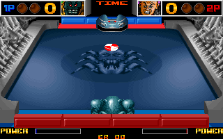

# Speed Fight: the board starts from a file in the game's own repository

<!-- demo-motion:begin -->
<p align="center"><picture><source media="(prefers-reduced-motion: reduce)" srcset="screen.png"></picture></p>

1. `run_to` stopped where the attract demo starts, and `record` films it.

<!-- moments-ms: 2600 -->
<!-- demo-motion:end -->

*Speed Fight* (Eco-Games / GAMART, 1994) ran on the same NEC V30 arcade board as *LineUp*.
This demo starts it from a start profile, a saved set of `start` arguments the game's own
repository keeps in `.scry/start/speedf.json`. Then it runs to the routine that begins the
attract demo and reads two variables by name.

## The program

Speed Fight is not distributed with this repository. The demo needs a built copy of the game,
with its ROM set in place and its `build/`, `run/` and `.scry/` folders.
It also needs a MAME whose driver list includes `speedf`.

## Run it

```sh
uv run python demos/speedf/demo.py --cwd /path/to/speedf-mame
```

Each line it prints is one call and its check. The window opens behind the others, so the run
does not take your keyboard.

- `--cwd PATH` (absolute or `~`-led) is the directory holding the game. Its `.scry/`
  holds the start profile, and its `build/` and `run/` hold what the profile names.
- `--rompath PATH` names another ROM set directory. Left out, it is the profile's
  `run/mame_roms`.
- `--binary PATH` picks the MAME to start. Left out, it is the profile's `MAME_BINARY`.
- `--display N` opens the window on that display. Left out, it opens on the main one.
- `--transcript PATH` moves the whole transcript; the run's other files go beside it.
- `--update-readme` rewrites this page's generated parts, `TRANSCRIPT.md`, `screen.png` and
  `loop.webp`, from a run where every step passed. It needs ffmpeg and `img2webp` on your
  `PATH`.

Exit codes: 0 every step passed, 1 a step failed, 2 a usage error, 3 nothing was demonstrated.
That last one is a checkout without its start profile or its build, a relative path or a
server that did not start.

## Try it yourself

[Add the server to your client](../../README.md#install) and open it in your checkout of the
game. Each of these is a step of the demo, in the order the demo makes them.

<!-- demo-transcript:begin -->
### 1. Start from the game's own start profile

Ask:

> Start Speed Fight from the start profile its repository keeps in `.scry/start/`.

Call:

```text
start(shared=true, background=true, display="<host>", profile="<host>", inipath="<host>",
    state_dir="<host>")
```

Reply, 3 of 36 fields:

```json
{
  "rom_check": "OK",
  "symbols_total": 225,
  "kept": "1 saved for `promote`"
}
```

A start profile is a saved set of `start` arguments; the call adds only this run's own. `rom_check` says the ROM in memory is the build's, `symbols_total` counts its map's names, and `kept` that a candidate was saved.

<details><summary>The whole reply</summary>

```json
{
  "summary": "<volatile>",
  "status": "ok",
  "system": "speedf",
  "binary": "<volatile>",
  "binary_origin": "<volatile>",
  "version": "0.289 (unknown)",
  "pid": "<volatile>",
  "stub_port": "<volatile>",
  "scratch_dir": "<volatile>",
  "state_dir": "./tmp/demos/speedf/speedf-states",
  "cfg": {"available": false, "why": "no cfg was given, so MAME runs on its defaults"},
  "debugger": {
    "attached": "gdbstub",
    "note": "MAME runs with -debug under this stub. A capture taken at one of this session's stops can land a frame away from an autoboot golden taken by a frame notifier at the same count, in a scene that changes every frame: compare a live capture with a live golden"
  },
  "errorlog_path": "<volatile>",
  "stdout_path": "<volatile>",
  "rom_check": "OK",
  "symbols_total": 225,
  "symbols_format": "tsv",
  "symbols_by_class": {"CODE": 167, "DATA": 58},
  "symbols_by_cpu": {":maincpu": 225},
  "registers": ["EAX", "ECX", "EDX", "EBX", "ESP", "EBP", "ESI", "EDI", "EIP", "EFLAGS", "CS", "SS", "DS", "ES", "FS", "GS", "ST0", "ST1", "ST2", "ST3", "ST4", "ST5", "ST6", "ST7", "FCTRL", "FSTAT", "FTAG", "FISEG", "FIOFF", "FOSEG", "FOOFF", "FOP"],
  "pc": "0x000ffff0",
  "frame": 0,
  "frame_symbol": "frame",
  "view": "native",
  "views": ["Screen 0 Standard (4:3)", "Screen 0 Pixel Aspect (8:5)", "Cocktail"],
  "background": true,
  "flags": "<volatile>",
  "boot_lua_path": "<volatile>",
  "presence": true,
  "machine": {"cpus": 1, "spaces": 2, "address_map": 16, "regions": 2, "shares": 0, "screens": 1, "rom_files": 3},
  "declarations": {
    "persistent": true,
    "path": "./tmp/demos/speedf/speedf-states/declarations.json",
    "key": "<volatile>",
    "held": 0,
    "fingerprint": "e08811564190b354",
    "rearm": {"rearmed": [], "stale": [], "unresolved": [], "unarmable": [], "evaluated": []},
    "comments": {"rearmed": [], "stale": [], "unresolved": [], "unarmable": []}
  },
  "recommended_release": "0.289",
  "window": "<volatile>",
  "kept": "1 saved for `promote`",
  "profile": {
    "name": "<volatile>",
    "file": "<volatile>",
    "supplied": ["bases", "binary", "boot_seconds", "reference_addr", "reference_base", "reference_rom", "rompath", "symbols", "system"]
  },
  "session": {
    "alive": true,
    "running": false,
    "altered": false,
    "altering_writes": 0,
    "console": {"thread_errors": 0, "reruns": 0, "lost": 0}
  }
}
```

</details>

### 2. Run to a routine by its name

Ask:

> Run the game until its attract demo starts, at `startdemo`, counting the video interrupt on the way.

Call:

```text
run_to(ref="startdemo", control="new_irq_video", seconds=300)
```

Reply, 3 of 15 fields:

```json
{
  "summary": "run_to startdemo: TARGET, control counted 920",
  "verdict": "TARGET",
  "control_hits": 920
}
```

`TARGET` means the run stopped at `startdemo`. `control_hits` counts the video interrupt meanwhile, so a run that never arrived would still say the game was running.

<details><summary>The whole reply</summary>

```json
{
  "summary": "run_to startdemo: TARGET, control counted 920",
  "status": "ok",
  "verdict": "TARGET",
  "control_hits": 920,
  "controls": [
    {"ref": "new_irq_video", "cpu": ":maincpu", "hits_in_run": 920}
  ],
  "cause": "target startdemo",
  "stop_seq": 2,
  "pc": "0x000f5e2f",
  "cpu": ":maincpu",
  "frame": 923,
  "regs": {
    "EAX": "0x0000",
    "ECX": "0x0000",
    "EDX": "0x0000",
    "EBX": "0x0421",
    "ESP": "0xbfce",
    "EBP": "0x0037",
    "ESI": "0x300f",
    "EDI": "0xb00f",
    "EIP": "0x000f5e2f",
    "EFLAGS": "0xf047",
    "CS": "0xed00",
    "SS": "0x0040",
    "DS": "0x0040",
    "ES": "0x1000",
    "FS": "0x00000000",
    "GS": "0x00000000",
    "ST0": "0x00000000000000000000",
    "ST1": "0x00000000000000000000",
    "ST2": "0x00000000000000000000",
    "ST3": "0x00000000000000000000",
    "ST4": "0x00000000000000000000",
    "ST5": "0x00000000000000000000",
    "ST6": "0x00000000000000000000",
    "ST7": "0x00000000000000000000",
    "FCTRL": "0x00000000",
    "FSTAT": "0x00000000",
    "FTAG": "0x00000000",
    "FISEG": "0x00000000",
    "FIOFF": "0x00000000",
    "FOSEG": "0x00000000",
    "FOOFF": "0x00000000",
    "FOP": "0x00000000"
  },
  "instruction": {"address": "F5E2F", "bytes": "06", "text": "push    ds1", "symbol": "startdemo", "delta": 0},
  "following": ["F5E30: 1E             push    ds0", "F5E31: 1E             push    ds0", "F5E32: 07             pop     ds1", "F5E33: 0E             push    ps", "F5E34: 1F             pop     ds0", "F5E35: 8B D8          mov     bw,aw", "F5E37: D1 E3          shl     bw,1", "F5E39: D1 E3          shl     bw,1", "F5E3B: 26 8B B7 45 CE mov     ix,ds1:[bw-31BBh]", "F5E40: BF 35 CA       mov     iy,0CA35h", "F5E43: 2E 8B 0C       mov     cw,ps:[ix]", "F5E46: 83 C1 04       add     cw,4h", "F5E49: F3 A4          rep     movbkb  ", "F5E4B: 26 8B B7 47 CE mov     ix,ds1:[bw-31B9h]"],
  "errorlog": "<volatile>",
  "session": {
    "alive": true,
    "running": false,
    "altered": false,
    "omitted": ["altering_writes", "console"],
    "how": "<volatile>"
  }
}
```

</details>

### 3. Read a variable by its name

Ask:

> Read the game's `creditos` variable.

Call:

```text
read_memory(ref="creditos", length=2)
```

Reply, 3 of 8 fields:

```json
{
  "summary": "read_memory creditos: 2 bytes at 0x0000c41c: 0000",
  "addr": "0x0000c41c",
  "hex": "0000"
}
```

`creditos` is a name from the game's symbol map. The start profile says where the game's data sits in RAM, so the name resolves to the address the program reads.

<details><summary>The whole reply</summary>

```json
{
  "summary": "read_memory creditos: 2 bytes at 0x0000c41c: 0000",
  "status": "ok",
  "ref": "creditos",
  "addr": "0x0000c41c",
  "length": 2,
  "hex": "0000",
  "cpu": ":maincpu",
  "session": {
    "alive": true,
    "running": false,
    "altered": false,
    "omitted": ["altering_writes", "console"],
    "how": "<volatile>"
  }
}
```

</details>
<!-- demo-transcript:end -->

<details><summary>The whole demo as one prompt</summary>

1. Start the board from the start profile `.scry/start/speedf.json` in the checkout, with a
   window.
2. Run to `startdemo` counting `new_irq_video`.
3. Read `_sceneId` and `creditos`.
4. Record 180 frames of video, take a picture of the screen and close.

</details>

## Tools this demo uses

| Group | Tools |
|---|---|
| [Session](../../docs/reference/session.md) | `start`, `close` |
| [Run](../../docs/reference/run.md) | `run_to` |
| [Read](../../docs/reference/read.md) | `read_memory` |
| [Captures](../../docs/reference/captures.md) | `record` |
| [Screen](../../docs/reference/screen.md) | `screen_view` |

Each group is a page of the reference. Run holds the tools that let the program run and
stop it again.

## The transcript

[TRANSCRIPT.md](TRANSCRIPT.md) has every call of the run with its reply. The paths of the
checkout read `<host>` there, because they are your computer's.
