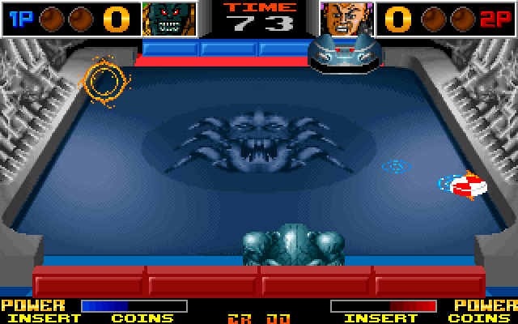

# Speed Fight: the board boots from the game's own recipe



*Speed Fight* (Eco-Games / GAMART, 1994) ran on the same NEC V30 arcade board as *LineUp*, with
an OKI M6295 for its sound. This demo boots it from the run recipe the game's own repository
declares in `.scry/start/speedf.json`: the set, the romset, the ini directory, the linker's image
as the known answer and the symbol map with its `DATA` base. The call gives only what is the
run's own, and the reply says which keys the recipe filled.

It then runs to the routine that starts the attract's demo, counting the video interrupt
meanwhile, reads the scene the dispatcher is on and the credits by name, lets the demo play, and
saves a picture of the board.

## The game

Speed Fight is not distributed with this repository, and its repository is private. The demo
needs a checkout of it, built and staged (`make rom`, `make stage-rom`), and a MAME whose driver
list includes `speedf`: the recipe names it through `MAME_BINARY`, and `--binary` names another.

## Run it

```sh
uv run python demos/speedf/demo.py --cwd /path/to/speedf-mame
```

- `--cwd PATH` (absolute or `~`-led) is the game's own repository checkout, whose `.scry/`
  declares the recipe and whose `build/` and `run/` hold what it names.
- `--rompath PATH` names another romset directory; left out, the recipe's `run/mame_roms`.
- `--binary PATH` picks the MAME to start; left out, the recipe's `MAME_BINARY`.
- The window opens in front, scaled to be seen.
- `--transcript PATH` moves the whole transcript; the run's other files go beside it.
- `--update-readme` rewrites the block below, `TRANSCRIPT.md` and `screen.png` from a run where
  every step passed.

Each line it prints is one call and its check. Exit codes: 0 every step passed, 1 a step failed,
2 a usage error, 3 nothing was demonstrated (a checkout without its recipe or its build, a
relative path, a server that did not start).

## The prompt

Give this to an MCP client with this server connected:

> Start the board from the recipe `.scry/start/speedf.json` in the `--cwd` checkout, with a
> window. Run to `startdemo` counting `new_irq_video`, read `_sceneId` and `creditos`, run three
> seconds, save a picture of the screen and close.

## The transcript

<!-- demo-transcript:begin -->
The run is 7 calls; these are the ones that show how it is done, and every call with its reply is in [TRANSCRIPT.md](TRANSCRIPT.md).

**1. `start`**: OK start: speedf on MAME from the game's own recipe (9 keys), rom_check OK, 223 symbols

`start(profile=...)` boots from the recipe the game's own repository declares: the set, the romset, the ini directory, the linker's image as the known answer and the symbol map with its `DATA` base. The call gives only what is the run's own, and the reply says which keys the recipe filled.

<details><summary>call and reply</summary>

```json
{
  "profile": "<host>",
  "inipath": "<host>",
  "state_dir": "<host>",
  "shared": true
}
```

```json
{
  "summary": "<volatile>",
  "status": "ok",
  "system": "speedf",
  "binary": "<volatile>",
  "binary_origin": "<volatile>",
  "version": "0.289 (unknown)",
  "pid": "<volatile>",
  "stub_port": "<volatile>",
  "scratch_dir": "<volatile>",
  "state_dir": "./tmp/demos/speedf/speedf-states",
  "cfg": {"available": false, "why": "no cfg was given, so MAME runs on its defaults"},
  "debugger": {
    "attached": "gdbstub",
    "note": "MAME runs with -debug under this stub. A capture taken at one of this session's stops can land a frame away from an autoboot golden taken by a frame notifier at the same count, in a scene that changes every frame: compare a live capture with a live golden"
  },
  "errorlog_path": "<volatile>",
  "stdout_path": "<volatile>",
  "rom_check": "OK",
  "symbols_total": 223,
  "symbols_format": "tsv",
  "symbols_by_class": {"CODE": 167, "DATA": 56},
  "symbols_by_cpu": {":maincpu": 223},
  "registers": ["EAX", "ECX", "EDX", "EBX", "ESP", "EBP", "ESI", "EDI", "EIP", "EFLAGS", "CS", "SS", "DS", "ES", "FS", "GS", "ST0", "ST1", "ST2", "ST3", "ST4", "ST5", "ST6", "ST7", "FCTRL", "FSTAT", "FTAG", "FISEG", "FIOFF", "FOSEG", "FOOFF", "FOP"],
  "pc": "0x000ffff0",
  "frame": 0,
  "frame_symbol": "frame",
  "view": "native",
  "views": ["Screen 0 Standard (4:3)", "Screen 0 Pixel Aspect (8:5)", "Cocktail"],
  "background": false,
  "flags": "<volatile>",
  "boot_lua_path": "<volatile>",
  "presence": true,
  "machine": {"cpus": 1, "spaces": 2, "address_map": 18, "regions": 2, "shares": 0, "screens": 1, "rom_files": 3},
  "declarations": {
    "persistent": true,
    "path": "./tmp/demos/speedf/speedf-states/declarations.json",
    "key": "<volatile>",
    "held": 0,
    "fingerprint": "6b931583c3fb8832",
    "rearm": {"rearmed": [], "stale": [], "unresolved": [], "unarmable": [], "evaluated": []},
    "comments": {"rearmed": [], "stale": [], "unresolved": [], "unarmable": []}
  },
  "recommended_release": "0.289",
  "window": {
    "display": 0,
    "bounds": {"x": 224, "y": 30, "width": 1600, "height": 1032},
    "onscreen": true,
    "front": true,
    "fullscreen": false
  },
  "kept": "kept 1 (promote to review)",
  "profile": {
    "name": "<volatile>",
    "file": "<volatile>",
    "supplied": ["bases", "binary", "boot_seconds", "reference_addr", "reference_base", "reference_rom", "rompath", "symbols", "system"]
  },
  "session": {
    "alive": true,
    "running": false,
    "altered": false,
    "altering_writes": 0,
    "console": {"thread_errors": 0, "reruns": 0, "lost": 0}
  }
}
```

</details>

**2. `run_to`**: OK to the demo: stopped at startdemo

`run_to` takes the game's own routine name from its map and runs the board until the attract's demo starts; `control` is the video interrupt, counted meanwhile, so a run that missed its target says whether the machine was running at all.

<details><summary>call and reply</summary>

```json
{
  "ref": "startdemo",
  "control": "new_irq_video",
  "seconds": 300
}
```

```json
{
  "summary": "run_to startdemo: TARGET, control counted 920",
  "status": "ok",
  "verdict": "TARGET",
  "control_hits": 920,
  "controls": [
    {"ref": "new_irq_video", "cpu": ":maincpu", "hits_in_run": 920}
  ],
  "cause": "target startdemo",
  "stop_seq": 2,
  "pc": "0x000f5e2f",
  "cpu": ":maincpu",
  "frame": 923,
  "regs": {
    "EAX": "0x0000",
    "ECX": "0x0000",
    "EDX": "0x0000",
    "EBX": "0x0421",
    "ESP": "0xbfce",
    "EBP": "0x0037",
    "ESI": "0x300f",
    "EDI": "0xb00f",
    "EIP": "0x000f5e2f",
    "EFLAGS": "0xf047",
    "CS": "0xed00",
    "SS": "0x0040",
    "DS": "0x0040",
    "ES": "0x1000",
    "FS": "0x00000000",
    "GS": "0x00000000",
    "ST0": "0x00000000000000000000",
    "ST1": "0x00000000000000000000",
    "ST2": "0x00000000000000000000",
    "ST3": "0x00000000000000000000",
    "ST4": "0x00000000000000000000",
    "ST5": "0x00000000000000000000",
    "ST6": "0x00000000000000000000",
    "ST7": "0x00000000000000000000",
    "FCTRL": "0x00000000",
    "FSTAT": "0x00000000",
    "FTAG": "0x00000000",
    "FISEG": "0x00000000",
    "FIOFF": "0x00000000",
    "FOSEG": "0x00000000",
    "FOOFF": "0x00000000",
    "FOP": "0x00000000"
  },
  "instruction": {"address": "F5E2F", "bytes": "06", "text": "push    ds1", "symbol": "startdemo", "delta": 0},
  "following": ["F5E30: 1E             push    ds0", "F5E31: 1E             push    ds0", "F5E32: 07             pop     ds1", "F5E33: 0E             push    ps", "F5E34: 1F             pop     ds0", "F5E35: 8B D8          mov     bw,aw", "F5E37: D1 E3          shl     bw,1", "F5E39: D1 E3          shl     bw,1", "F5E3B: 26 8B B7 45 CE mov     ix,ds1:[bw-31BBh]", "F5E40: BF 35 CA       mov     iy,0CA35h", "F5E43: 2E 8B 0C       mov     cw,ps:[ix]", "F5E46: 83 C1 04       add     cw,4h", "F5E49: F3 A4          rep     movbkb  ", "F5E4B: 26 8B B7 47 CE mov     ix,ds1:[bw-31B9h]"],
  "errorlog": {
    "lines_total": 3,
    "truncated": false,
    "lines": ["[:] 0fa039: spider_blitter_w unhandled RAM access 000f7006 0000 ff00", "[:oki] Requested to play sample 44 on non-stopped voice", "[:oki] Requested to play sample 45 on non-stopped voice"],
    "mark": 126
  },
  "session": {
    "alive": true,
    "running": false,
    "altered": false,
    "omitted": ["altering_writes", "console"],
    "how": "call `status`"
  }
}
```

</details>

**4. `read_memory`**: OK no credits: creditos holds 0

`creditos` is read by name through the map's `DATA` base: the map holds the ROM address of the initialised copy, and the program reads its variables at paragraph `0x40`, which the recipe's `bases` declares.

<details><summary>call and reply</summary>

```json
{
  "ref": "creditos",
  "length": 2
}
```

```json
{
  "summary": "read_memory creditos: 2 bytes at 0x0000c41c: 0000",
  "status": "ok",
  "addr": "0x0000c41c",
  "length": 2,
  "hex": "0000",
  "cpu": ":maincpu",
  "session": {
    "alive": true,
    "running": false,
    "altered": false,
    "omitted": ["altering_writes", "console"],
    "how": "call `status`"
  }
}
```

</details>
<!-- demo-transcript:end -->
