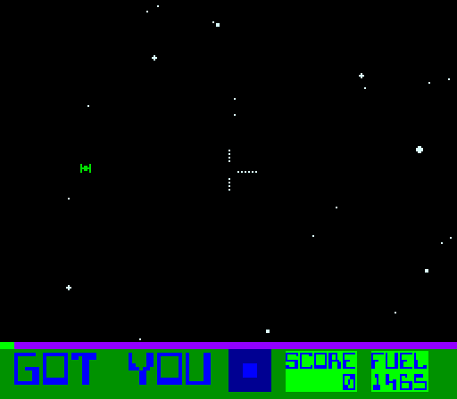

# Star Fire: a coin, found and caught



Exidy's *Star Fire* (1979) is a first-person space shooter on a Z80. This demo boots it, lets its
attract mode run, drops coins into it and goes looking for where the game keeps them: a value
scan narrows the first kilobyte of scratch RAM to the one byte that counts credits, a watch on
that byte stops the machine on the instruction that bumps it, and a saved state takes a fifth
coin back.

## The ROM

The set is one of the ROMs [mamedev.org](https://www.mamedev.org/roms/) distributes for free,
non-commercial use, from its own site only, so it is not in this repository. Get it and check it
with your MAME:

```sh
mkdir -p ~/roms && curl -fL -o ~/roms/starfire.zip https://www.mamedev.org/roms/starfire/starfire.zip
mame -rompath ~/roms -verifyroms starfire
```

## Run it

```sh
uv run python demos/starfire/demo.py --rompath ~/roms
```

- `--binary PATH` picks the MAME to start; left out, `MAME_BINARY`, else the `mame` on your
  `PATH`.
- `--shared` is for a run somebody watches: MAME opens in front, in a window scaled to be seen.
  Left out, it runs in a small window behind your work.
- `--transcript PATH` moves the whole transcript; the run's other files go beside it.
- `--update-readme` rewrites the block below, `TRANSCRIPT.md` and `screen.png` from a run where every step
  passed.

Each line it prints is one call and its check. Exit codes: 0 every step passed, 1 a step
failed, 2 a usage error, 3 nothing was demonstrated (a missing ROM, a relative path, a server
that did not start). Star Fire's sound is emulated from its circuit diagram, which is expensive: under the
debugger the emulation cannot keep up with real time, so a run takes far longer than the game
seconds it plays, and a watched one moves slowly.

## The prompt

Give this to an MCP client with this server connected:

> Start `starfire` with the ROMs in `~/roms` (as an absolute path), checking it against its
> first program ROM, `r1412-11.1a` (CRC 9990AF64), unzipped from `starfire.zip` and given as the
> reference image at `0x0`. Let the attract mode run for three seconds. Then find the credit
> counter: open a value scan over `0x8000`, 1 KB, and after each of three coins (`:SYSTEM`,
> `Coin 1`, held four frames) and half a second of running, keep only the bytes that equal the
> number of coins so far. Put a watch that stops on a change of the byte that is left and drop a
> fourth coin: tell me which instruction writes it, disassemble 16 bytes from `0x1e40`, and show
> me the last 12 instructions executed and the registers. Run half a second more so the coin
> releases, clear the watch and read the credits. Save a state, drop a fifth coin the same way
> and read the credits, then load the state and read them again. Take a picture of the screen
> and close the session.

## What it walks

| Family | Calls |
|---|---|
| Session | `start` (checked against the ROM), `close` |
| Advance | `run_for` by emulated milliseconds, with its frame and cycle survey |
| Scan | `scan(method="start")` and `scan(method="filter")` to find the credits |
| Declarations | `watch_add`, whose stop names the writer, and `declaration_clear(kind="watch")` |
| Read | `read_memory`, `disassemble`, `history`, `registers` |
| Lua | `input` (the coin slot, held four frames) |
| Lists | `perform` (coin, run, filter in one call) |
| States | `state_write(method="save")`, `state_write(method="load")` (verified) |
| Screen | `screen_view` |

## The transcript

Generated by `demo.py --update-readme` from a run where every step passed, with the ROM and MAME
reached through links under the repository's own `tmp/` (`tmp/roms`, `tmp/bin/mame`), so the
paths read the same on any host; temporary paths, process ids and wall-clock counts read
`<volatile>`.

<!-- demo-transcript:begin -->
The run is 21 calls; these are the ones that show how it is done, and every call with its reply is in [TRANSCRIPT.md](TRANSCRIPT.md).

**6. `perform`**: OK coin 3: coin 3: one cell left, 0x00008299, holding 3

A value scan narrows the first kilobyte of scratch RAM: after the first coin the cells holding 1, after the second those holding 2, and after the third one cell is left. That byte is the credits.

<details><summary>call and reply</summary>

```json
{
  "steps": [
    {"op": "input", "port": ":SYSTEM", "field": "Coin 1", "frames": 4, "seconds": 300},
    {"op": "run_for", "milliseconds": 500, "seconds": 300},
    {"op": "scan", "method": "filter", "operator": "=", "value": 3}
  ],
  "settle_seconds": 300
}
```

```json
{
  "summary": "perform: 3 steps completed",
  "status": "ok",
  "ran": [
    {
      "op": "input",
      "cpu": ":maincpu",
      "reply": {
        "summary": "input :SYSTEM 'Coin 1': held 4 frames, active True, released at frame 253",
        "status": "ok",
        "verdict": "ELAPSED",
        "frame_before": 249,
        "frame_after": 254,
        "emulated_before_s": 4.178907,
        "emulated_after_s": 4.262483,
        "cycles": 208941,
        "polls": 6,
        "lines_ahead": 0,
        "thread_errors": 0,
        "console_reruns": 0,
        "route": "ioport",
        "port": ":SYSTEM",
        "field": "Coin 1",
        "value": "0x00000001",
        "frames": 4,
        "name": "Coin 1",
        "player": 0,
        "mask": "0x00000001",
        "defvalue": "0x00000000",
        "port_before": "0x000000f8",
        "frame_set": 249,
        "released": true,
        "port_held": "0x000000f9",
        "frame_released": 253,
        "active": true,
        "cause": "the `gvblank` stop of the last frame asked",
        "stop_seq": 7,
        "pc": "0x00000066",
        "cpu": ":maincpu",
        "frame": 254,
        "regs": {
          "AF": "0x4780",
          "BC": "0x0c00",
          "DE": "0x8003",
          "HL": "0x8265",
          "AF'": "0x0000",
          "BC'": "0x0000",
          "DE'": "0x0000",
          "HL'": "0x0000",
          "IX": "0x820d",
          "IY": "0x82af",
          "SP": "0x807b",
          "PC": "0x0066",
          "IR": "0x0018"
        },
        "instruction": {
          "address": "0066",
          "bytes": "C36900",
          "text": "jp   $0069",
          "symbol": {"available": false, "why": "no symbol table places this address"},
          "delta": {"available": false, "why": "no symbol table places this address"}
        },
        "following": ["0069: F5       push af", "006A: E5       push hl", "006B: D5       push de", "006C: 97       sub  a", "006D: 67       ld   h,a", "006E: 6F       ld   l,a", "006F: 39       add  hl,sp", "0070: 11 15 80 ld   de,$8015", "0073: ED 52    sbc  hl,de", "0075: B4       or   h", "0076: C2 00 00 jp   nz,$0000", "0079: B5       or   l", "007A: FA 00 00 jp   m,$0000", "007D: FE 78    cp   $78", "007F: F2 00 00 jp   p,$0000", "0082: 21 67 83 ld   hl,$8367", "0085: 34       inc  (hl)"],
        "errorlog": {
          "lines_total": 2,
          "truncated": false,
          "lines": ["[luaengine] MAME_MCP_INPUT#3 release frame=253 port_held=000000f9", ""],
          "mark": 1585
        },
        "session": {
          "alive": true,
          "running": false,
          "altered": false,
          "omitted": ["altering_writes", "console"],
          "how": "call `status`"
        }
      }
    },
    {
      "op": "run_for",
      "cpu": ":maincpu",
      "reply": {
        "summary": "run_for 500 ms: ELAPSED, frame 254 to 284",
        "status": "ok",
        "verdict": "ELAPSED",
        "frame_before": 254,
        "frame_after": 284,
        "emulated_before_s": 4.262483,
        "emulated_after_s": 4.762487,
        "cycles": 1250010,
        "reads": "<volatile>",
        "cause": "the console's `gtime` stop",
        "stop_seq": 8,
        "pc": "0x00002b38",
        "cpu": ":maincpu",
        "frame": 284,
        "regs": {
          "AF": "0xb5b3",
          "BC": "0x00c9",
          "DE": "0xdbb5",
          "HL": "0x0038",
          "AF'": "0x0000",
          "BC'": "0x0000",
          "DE'": "0x0000",
          "HL'": "0x0000",
          "IX": "0x8255",
          "IY": "0x82af",
          "SP": "0x808d",
          "PC": "0x2b38",
          "IR": "0x0039"
        },
        "instruction": {
          "address": "2B38",
          "bytes": "18FE",
          "text": "jr   $2B38",
          "symbol": {"available": false, "why": "no symbol table places this address"},
          "delta": {"available": false, "why": "no symbol table places this address"}
        },
        "following": ["2B3A: 21 CC 0C ld   hl,$0CCC", "2B3D: 2B       dec  hl", "2B3E: 7C       ld   a,h", "2B3F: B5       or   l", "2B40: 20 FB    jr   nz,$2B3D", "2B42: C9       ret", "2B43: 3E FF    ld   a,$FF", "2B45: 32 7B 83 ld   ($837B),a", "2B48: CD 45 23 call $2345", "2B4B: CD 2B 12 call $122B", "2B4E: CD 93 09 call $0993", "2B51: 97       sub  a", "2B52: 32 01 94 ld   ($9401),a", "2B55: 32 00 94 ld   ($9400),a"],
        "errorlog": {"lines_total": 0, "truncated": false, "lines": [], "mark": 1652},
        "session": {
          "alive": true,
          "running": false,
          "altered": false,
          "omitted": ["altering_writes", "console"],
          "how": "call `status`"
        }
      }
    },
    {
      "op": "scan",
      "cpu": ":maincpu",
      "reply": {
        "summary": "scan filter: = 0x03, 1 survivor",
        "status": "ok",
        "operator": "=",
        "value": "0x03",
        "iterations": 3,
        "closed": false,
        "hits": [
          {"addr": "0x00008299", "value": "0x03"}
        ],
        "hits_total": 1,
        "truncated": false,
        "cpu": ":maincpu",
        "space": "program",
        "session": {
          "alive": true,
          "running": false,
          "altered": false,
          "omitted": ["altering_writes", "console"],
          "how": "call `status`"
        }
      }
    }
  ],
  "steps_completed": 3,
  "failed_at": {"available": false, "why": "no step failed"},
  "held": 0,
  "visible_cpu": ":maincpu",
  "visible_cpu_kept": {"before": ":maincpu", "after": ":maincpu", "restored": false},
  "session": {
    "alive": true,
    "running": false,
    "altered": false,
    "omitted": ["altering_writes", "console"],
    "how": "call `status`"
  }
}
```

</details>

**8. `input`**: OK coin 4: the fourth coin stopped the machine: Stopped at watchpoint 1 writing 04 to 8299 (PC=1E48)

A change watch on that byte stops the emulator on the instruction that writes it, and the reply is the stop itself: which watchpoint, the value written and the program counter. No polling, no guess about timing.

<details><summary>call and reply</summary>

```json
{
  "port": ":SYSTEM",
  "field": "Coin 1",
  "frames": 4,
  "seconds": 300
}
```

```json
{
  "summary": "input :SYSTEM 'Coin 1': still HELD from frame 284, releases at 288",
  "status": "ok",
  "verdict": "OTHER_STOP",
  "frame_before": 284,
  "frame_after": 284,
  "emulated_before_s": 4.764453,
  "emulated_after_s": 4.764453,
  "cycles": 0,
  "polls": 2,
  "lines_ahead": 0,
  "thread_errors": 0,
  "console_reruns": 0,
  "route": "ioport",
  "port": ":SYSTEM",
  "field": "Coin 1",
  "value": "0x00000001",
  "frames": 4,
  "name": "Coin 1",
  "player": 0,
  "mask": "0x00000001",
  "defvalue": "0x00000000",
  "port_before": "0x000000f8",
  "frame_set": 284,
  "released": false,
  "active": {
    "available": false,
    "why": "the field is still HELD: the port is read at its release, which the run has not reached"
  },
  "port_held": {
    "available": false,
    "why": "the field is still HELD: the port is read at its release, which the run has not reached"
  },
  "frame_release_planned": 288,
  "note": "the field is still HELD: the run stopped before the release frame, and the script releases it when the machine reaches it",
  "cause": "watch 0x8299: 0x00008299 written by pc 0x00001e48",
  "stop_seq": 9,
  "pc": "0x00001e49",
  "cpu": ":maincpu",
  "frame": 284,
  "regs": {
    "AF": "0x0200",
    "BC": "0x0003",
    "DE": "0x0015",
    "HL": "0x8299",
    "AF'": "0x0000",
    "BC'": "0x0000",
    "DE'": "0x0000",
    "HL'": "0x0000",
    "IX": "0x8255",
    "IY": "0x82af",
    "SP": "0x8073",
    "PC": "0x1e49",
    "IR": "0x0004"
  },
  "instruction": {
    "address": "1E49",
    "bytes": "21AF82",
    "text": "ld   hl,$82AF",
    "symbol": {"available": false, "why": "no symbol table places this address"},
    "delta": {"available": false, "why": "no symbol table places this address"}
  },
  "following": ["1E4C: 7E       ld   a,(hl)", "1E4D: B7       or   a", "1E4E: 28 09    jr   z,$1E59", "1E50: 36 00    ld   (hl),$00", "1E52: 06 04    ld   b,$04", "1E54: 2B       dec  hl", "1E55: 36 09    ld   (hl),$09", "1E57: 10 FB    djnz $1E54", "1E59: C3 33 22 jp   $2233", "1E5C: 21 B5 82 ld   hl,$82B5", "1E5F: 11 9D 82 ld   de,$829D", "1E62: 01 05 00 ld   bc,$0005", "1E65: ED B0    ldir", "1E67: 3A 00 98 ld   a,($9800)"],
  "errorlog": {"lines_total": 0, "truncated": false, "lines": [], "mark": 1772},
  "watches": [
    {
      "ref": "0x8299",
      "cpu": ":maincpu",
      "state": "armed",
      "reading": {"state": "bus", "last_wrote": 4, "read_maps_to": "starfire_base_state::scratch_r"}
    }
  ],
  "omitted": ["addr", "by", "entry", "fmt", "length", "mode"],
  "how": "`declaration_list(kind=\"watch\")` answers each watch whole: its declaration, the debugger's row for it, and a count's or a capture's tables",
  "watch_hit": {
    "ref": "0x8299",
    "addr": "0x00008299",
    "cpu": ":maincpu",
    "index": 1,
    "writes_total": 1,
    "truncated": false,
    "writer_pc": "0x00001e48",
    "writes": [
      {"wrote": "0x04", "to": "0x00008299", "pc": "0x00001e48"}
    ],
    "values_from": "bus",
    "before": {
      "available": false,
      "why": "the first write logged since the watch was armed: no earlier write to compare"
    },
    "after": 4,
    "lines": ["Stopped at watchpoint 1 writing 04 to 8299 (PC=1E48)"]
  },
  "session": {
    "alive": true,
    "running": false,
    "altered": false,
    "omitted": ["altering_writes", "console"],
    "how": "call `status`"
  }
}
```

</details>

**10. `history`**: OK history: 12 instructions led there, ending 1E49: ld hl,$82AF

`history` is the instructions the CPU ran up to the stop, the code that took the coin; `registers` then says what it was working on: HL points at the credits byte.

<details><summary>call and reply</summary>

```json
{
  "limit": 12
}
```

```json
{
  "summary": "history: 12 instructions of 12 asked",
  "status": "ok",
  "asked": 12,
  "lines": ["2640: ld   (hl),a", "2641: sub  $0A", "2643: ret  m", "1E3B: ld   hl,$8298", "1E3E: inc  (hl)", "1E3F: ld   a,(hl)", "1E40: cpl", "1E41: and  $03", "1E43: jr   z,$1E04", "1E45: ld   hl,$8299", "1E48: inc  (hl)", "1E49: ld   hl,$82AF"],
  "cpu": ":maincpu",
  "session": {
    "alive": true,
    "running": false,
    "altered": false,
    "omitted": ["altering_writes", "console"],
    "how": "call `status`"
  }
}
```

</details>
<!-- demo-transcript:end -->
