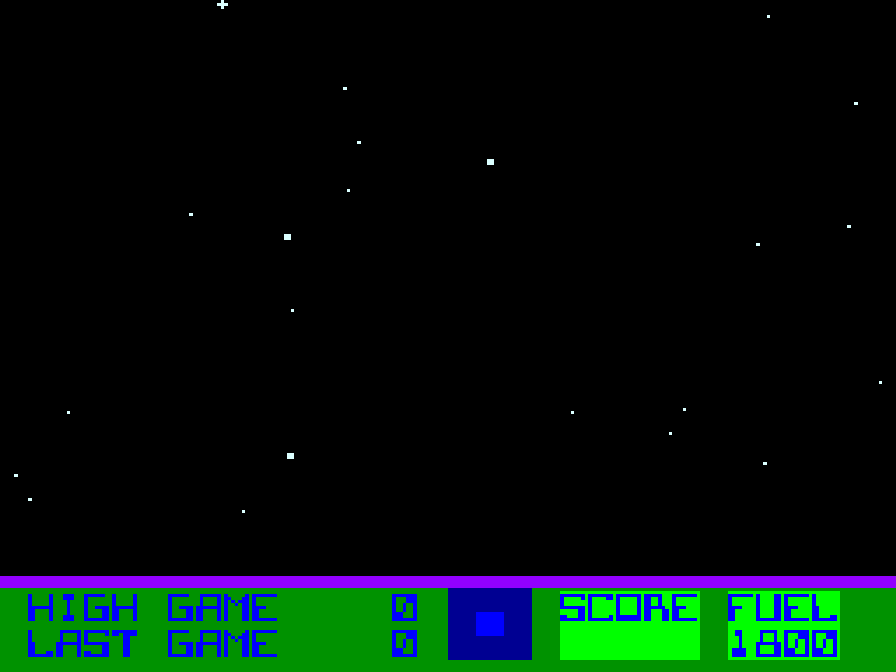

# Star Fire: find where the game counts its coins

<!-- demo-motion:begin -->
<picture><source media="(prefers-reduced-motion: reduce)" srcset="screen.png"></picture>

1. `input` drops a fifth coin: the screen redraws and FUEL reads 1800.
2. `state_write` loads the state saved at four coins, and FUEL is back at 1500.

<!-- moments-ms: 1504,1003 -->
<!-- demo-motion:end -->

Exidy's *Star Fire* (1979) is a space shooter on a Z80. This demo drops coins into it and finds
the byte that counts them with a value scan. A watch then stops the game on the instruction
that writes that byte, and a saved state takes a coin back.

## The ROM

[mamedev.org](https://www.mamedev.org/roms/) distributes this ROM for free, non-commercial use,
from its own site only, so it is not in this repository. Get it and check it with your MAME:

```sh
mkdir -p ~/roms
curl -fL -o ~/roms/starfire.zip https://www.mamedev.org/roms/starfire/starfire.zip
mame -rompath ~/roms -verifyroms starfire
```

## Run it

```sh
uv run python demos/starfire/demo.py --rompath ~/roms
```

Each line it prints is one call and its check. The window opens behind the others, so the run
does not take your keyboard.

- `--binary PATH` picks the MAME to start. Left out, it is `MAME_BINARY`, else the `mame` on
  your `PATH`.
- `--display N` opens the window on that display. Left out, it opens on the main one.
- `--transcript PATH` moves the whole transcript; the run's other files go beside it.
- `--update-readme` rewrites this page's generated parts, `TRANSCRIPT.md`, `screen.png`,
  `loop.webp` and the README's example calls, from a run where every step passed. It needs
  ffmpeg and `img2webp` on your `PATH`.

Exit codes: 0 every step passed, 1 a step failed, 2 a usage error, 3 nothing was demonstrated.
That last one is a missing ROM, a relative path or a server that did not start.

A run takes far longer than the game seconds it plays. Star Fire's sound is emulated from its
circuit diagram, which is expensive, and under the debugger MAME cannot keep up with real time.

## Try it yourself

[Add the server to your client](../../README.md#install) and ask it to start `starfire` with
the ROM in `~/roms`. Each of these is a step of the demo, in the order the demo makes them.

<!-- demo-transcript:begin -->
**1. Find a variable nobody named**

Ask:

> Three coins are in. Keep only the bytes of the scan that hold 3 now.

Call:

```text
scan(method="filter", operator="=", value=3)
```

Reply, 3 of 12 fields:

```json
{
  "summary": "scan filter: = 0x03, 1 survivor",
  "hits_total": 1,
  "hits": [
    {"addr": "0x00008299", "value": "0x03"}
  ]
}
```

One byte followed the coins from 1 to 3, so `0x8299` is the credits. A "survivor" is a byte still in the scan.

<details><summary>The whole reply</summary>

```json
{
  "summary": "scan filter: = 0x03, 1 survivor",
  "status": "ok",
  "operator": "=",
  "value": "0x03",
  "iterations": 3,
  "closed": false,
  "hits": [
    {"addr": "0x00008299", "value": "0x03"}
  ],
  "hits_total": 1,
  "truncated": false,
  "cpu": ":maincpu",
  "space": "program",
  "session": {
    "alive": true,
    "running": false,
    "altered": false,
    "omitted": ["altering_writes", "console"],
    "how": "<volatile>"
  }
}
```

</details>

**2. Catch the instruction that writes it**

Ask:

> With a change watch on `0x8299`, drop a fourth coin and tell me what wrote it.

Call:

```text
input(port=":SYSTEM", field="Coin 1", frames=4, seconds=300)
```

Reply, 3 of 42 fields:

```json
{
  "summary": "input :SYSTEM 'Coin 1': still HELD from frame 284, releases at 288",
  "verdict": "OTHER_STOP",
  "cause": "watch 0x8299: 0x00008299 written by pc 0x00001e48"
}
```

`OTHER_STOP` means the watch stopped the machine while the coin was still held. `cause` names the byte and the instruction that wrote it, at `0x1e48`.

<details><summary>The whole reply</summary>

```json
{
  "summary": "input :SYSTEM 'Coin 1': still HELD from frame 284, releases at 288",
  "status": "ok",
  "verdict": "OTHER_STOP",
  "frame_before": 284,
  "frame_after": 284,
  "emulated_before_s": 4.764453,
  "emulated_after_s": 4.764453,
  "cycles": 0,
  "polls": 2,
  "lines_ahead": 0,
  "thread_errors": 0,
  "console_reruns": 0,
  "route": "ioport",
  "port": ":SYSTEM",
  "field": "Coin 1",
  "value": "0x00000001",
  "frames": 4,
  "name": "Coin 1",
  "player": 0,
  "mask": "0x00000001",
  "defvalue": "0x00000000",
  "port_before": "0x000000f8",
  "frame_set": 284,
  "released": false,
  "active": {
    "available": false,
    "why": "the field is still HELD: the port is read at its release, which the run has not reached"
  },
  "port_held": {
    "available": false,
    "why": "the field is still HELD: the port is read at its release, which the run has not reached"
  },
  "frame_release_planned": 288,
  "note": "the field is still HELD: the run stopped before the release frame, and the script releases it when the machine reaches it",
  "cause": "watch 0x8299: 0x00008299 written by pc 0x00001e48",
  "stop_seq": 9,
  "pc": "0x00001e49",
  "cpu": ":maincpu",
  "frame": 284,
  "regs": {
    "AF": "0x0200",
    "BC": "0x0003",
    "DE": "0x0015",
    "HL": "0x8299",
    "AF'": "0x0000",
    "BC'": "0x0000",
    "DE'": "0x0000",
    "HL'": "0x0000",
    "IX": "0x8255",
    "IY": "0x82af",
    "SP": "0x8073",
    "PC": "0x1e49",
    "IR": "0x0004"
  },
  "instruction": {
    "address": "1E49",
    "bytes": "21AF82",
    "text": "ld   hl,$82AF",
    "symbol": {"available": false, "why": "no symbol table places this address"},
    "delta": {"available": false, "why": "no symbol table places this address"}
  },
  "following": ["1E4C: 7E       ld   a,(hl)", "1E4D: B7       or   a", "1E4E: 28 09    jr   z,$1E59", "1E50: 36 00    ld   (hl),$00", "1E52: 06 04    ld   b,$04", "1E54: 2B       dec  hl", "1E55: 36 09    ld   (hl),$09", "1E57: 10 FB    djnz $1E54", "1E59: C3 33 22 jp   $2233", "1E5C: 21 B5 82 ld   hl,$82B5", "1E5F: 11 9D 82 ld   de,$829D", "1E62: 01 05 00 ld   bc,$0005", "1E65: ED B0    ldir", "1E67: 3A 00 98 ld   a,($9800)"],
  "errorlog": "<volatile>",
  "watches": [
    {
      "ref": "0x8299",
      "cpu": ":maincpu",
      "state": "armed",
      "reading": {"state": "bus", "last_wrote": 4, "read_maps_to": "starfire_base_state::scratch_r"}
    }
  ],
  "omitted": ["addr", "by", "entry", "fmt", "length", "mode"],
  "how": "<volatile>",
  "watch_hit": {
    "ref": "0x8299",
    "addr": "0x00008299",
    "cpu": ":maincpu",
    "index": 1,
    "writes_total": 1,
    "truncated": false,
    "writer_pc": "0x00001e48",
    "writes": [
      {"wrote": "0x04", "to": "0x00008299", "pc": "0x00001e48"}
    ],
    "values_from": "bus",
    "before": {
      "available": false,
      "why": "the first write logged since the watch was armed: no earlier write to compare"
    },
    "after": 4,
    "lines": ["Stopped at watchpoint 1 writing 04 to 8299 (PC=1E48)"]
  },
  "session": {
    "alive": true,
    "running": false,
    "altered": false,
    "omitted": ["altering_writes", "console"],
    "how": "<volatile>"
  }
}
```

</details>

**3. Read how the program got there**

Ask:

> Show me the last eight instructions the CPU ran before that stop.

Call:

```text
history(limit=8)
```

Reply, 1 of 6 fields:

```json
{
  "lines": [
    "1E3E: inc  (hl)",
    "1E3F: ld   a,(hl)",
    "1E40: cpl",
    "1E41: and  $03",
    "1E43: jr   z,$1E04",
    "1E45: ld   hl,$8299",
    "1E48: inc  (hl)",
    "1E49: ld   hl,$82AF"
  ]
}
```

`history` lists what the CPU ran up to the stop, oldest first. `inc (hl)` at `1E48` is the write the watch caught, and the line after it is where the game stopped.

<details><summary>The whole reply</summary>

```json
{
  "summary": "history: 8 instructions of 8 asked",
  "status": "ok",
  "asked": 8,
  "lines": ["1E3E: inc  (hl)", "1E3F: ld   a,(hl)", "1E40: cpl", "1E41: and  $03", "1E43: jr   z,$1E04", "1E45: ld   hl,$8299", "1E48: inc  (hl)", "1E49: ld   hl,$82AF"],
  "cpu": ":maincpu",
  "session": {
    "alive": true,
    "running": false,
    "altered": false,
    "omitted": ["altering_writes", "console"],
    "how": "<volatile>"
  }
}
```

</details>

**4. Go back to before the coin**

Ask:

> Load the state you saved at four credits.

Call:

```text
state_write(method="load", name="four_credits")
```

Reply, 2 of 19 fields:

```json
{
  "summary": "state_write load: four-credits, rom_check OK, verified True, ... (85 characters)",
  "verified": true
}
```

`verified` is true: the server read the machine back after the load, and it is the saved one. The fifth coin is undone.

<details><summary>The whole reply</summary>

```json
{
  "summary": "state_write load: four-credits, rom_check OK, verified True, frame 314, pc 0x00002b38",
  "status": "ok",
  "name": "four-credits",
  "path": "./tmp/demos/starfire/starfire-states/sta/starfire/four-credits.sta",
  "rom_check": "OK",
  "verified": true,
  "saved": {"frame": 314, "pc": "0x00002b38"},
  "output": "State load attempted.  Please refer to window message popup for results.",
  "mark": "<volatile>",
  "cause": "stateload four-credits",
  "stop_seq": 13,
  "pc": "0x00002b38",
  "cpu": ":maincpu",
  "frame": 314,
  "regs": {
    "AF": "0xb5b3",
    "BC": "0x00c9",
    "DE": "0xdbb5",
    "HL": "0x0038",
    "AF'": "0x0000",
    "BC'": "0x0000",
    "DE'": "0x0000",
    "HL'": "0x0000",
    "IX": "0x8255",
    "IY": "0x82af",
    "SP": "0x808d",
    "PC": "0x2b38",
    "IR": "0x0029"
  },
  "instruction": {
    "address": "2B38",
    "bytes": "18FE",
    "text": "jr   $2B38",
    "symbol": {"available": false, "why": "no symbol table places this address"},
    "delta": {"available": false, "why": "no symbol table places this address"}
  },
  "following": ["2B3A: 21 CC 0C ld   hl,$0CCC", "2B3D: 2B       dec  hl", "2B3E: 7C       ld   a,h", "2B3F: B5       or   l", "2B40: 20 FB    jr   nz,$2B3D", "2B42: C9       ret", "2B43: 3E FF    ld   a,$FF", "2B45: 32 7B 83 ld   ($837B),a", "2B48: CD 45 23 call $2345", "2B4B: CD 2B 12 call $122B", "2B4E: CD 93 09 call $0993", "2B51: 97       sub  a", "2B52: 32 01 94 ld   ($9401),a", "2B55: 32 00 94 ld   ($9400),a"],
  "errorlog": "<volatile>",
  "session": {
    "alive": true,
    "running": false,
    "altered": true,
    "note": "this session has been MODIFIED: what is measured here does not describe a normal run of the game",
    "omitted": ["altering_writes", "console"],
    "how": "<volatile>"
  }
}
```

</details>
<!-- demo-transcript:end -->

<details><summary>The whole demo as one prompt</summary>

1. Start `starfire` with the ROMs in `~/roms`, checked against its first program ROM (CRC
   9990AF64) as the reference image at `0x0`.
2. Let the attract mode run for three seconds, then open a value scan over `0x8000`, 1 KB.
3. Three times: drop a coin (`:SYSTEM`, `Coin 1`, four frames), run half a second, and keep
   only the bytes that equal the coins so far.
4. Put a watch that stops on a change of the byte that is left, and drop a fourth coin.
5. Tell me which instruction wrote it, disassemble 16 bytes from `0x1e40`, and show the last
   8 instructions and the registers.
6. Run half a second so the coin releases, clear the watch, read the credits and save a state.
7. Drop a fifth coin, record 90 frames to an AVI and read the credits.
8. Load the state, record 60 frames, read the credits again, take a picture and close.

</details>

## Tools this demo uses

| Group | Tools |
|---|---|
| [Session](../../docs/reference/session.md) | `start`, `close` |
| [Advance](../../docs/reference/advance.md) | `run_for` |
| [Scan](../../docs/reference/scan.md) | `scan` |
| [Declarations](../../docs/reference/declarations.md) | `watch_add`, `declaration_clear` |
| [Read](../../docs/reference/read.md) | `read_memory`, `disassemble`, `history`, `registers` |
| [Lua](../../docs/reference/lua.md) | `input` |
| [Lists](../../docs/reference/lists.md) | `perform` |
| [States](../../docs/reference/states.md) | `state_write` |
| [Screen](../../docs/reference/screen.md) | `screen_view` |
| [Captures](../../docs/reference/captures.md) | `record` |

Each group is a page of the reference. Four of the names need a word:

- Advance: the tools that let the program run and stop it again.
- Declarations: breakpoints and watches.
- Lists: the tools that run several calls as one.
- Lua: the tools that reach MAME's own scripting, `input` among them.

## The transcript

[TRANSCRIPT.md](TRANSCRIPT.md) has every call of the run with its reply. The run reached the
ROM and MAME through links under the repository's own `tmp/`, so its paths read the same on
any computer.
